# 第一次使用：从解压到结束调节 · 0.9.26-public-preview.1

[English](guide.en.md) · [主页](../README.md) · [逐模块详解](modules.zh-CN.md) · [风险说明](SAFETY.zh-CN.md)

这篇按实际操作顺序走一遍。第一次先完成临时调节、查看回执和恢复；永久保存放在最后的可选分支。不需要编写代码。

| 阅读路线 | 适合什么时候用 |
| :--- | :--- |
| **本篇：首次使用全流程** | 第一次解压，按 1 → 8 顺序完成一次使用。 |
| **[逐模块详解](modules.zh-CN.md)** | 已经连接，想查某个按钮、参数增减效果、应用方式和恢复范围。 |
| **[算法与研究](RESEARCH.zh-CN.md)** | 想看 SF、Alpha、预算和驱动数值的实验依据。 |

**截图约定：** 所有 APP 教程图统一使用 **暗黑 MONO（素·黑白）**，来自 0.9.26 公开版实际本地界面的原生无损 PNG；点击图片可看原图。拍摄时未连接 ADB，灰色按钮、“—”和离线提示保留原样，没有模拟设备读数。截图数值只用于定位控件。显示器菜单图保留厂商原界面，仅裁切、遮挡隐私。

## 一条主线，两条结束分支

**1 准备 → 2 开启 ADB → 3 解压、备份、连接 → 4 选组合并改一项 → 5 看图样和回执 → 6 恢复临时会话 → 7 保存 PC 草稿 → 8 下次使用**

需要脱离电脑运行时，再走 [7B：实验性永久保存](#persistent)。每一步末尾都有完成标志；未完成就先处理当前提示。

## 1. 先准备电脑和显示器

### 1.1 核对范围、退出旧控制器

- 仅限 **REDMI 显示器 G Pro 32U 2026** 与推算的 **27U 2026** 分支；其他显示器不支持。27 寸没有实机验收，可能有各种 bug。
- 正常退出所有其他版本的调光工具。不同目录、不同 PC 端口仍可能同时控制同一台显示器。
- 保留一份完整便携目录和初始设备备份。不要在 ZIP 的预览窗口里运行 EXE，也不要只把 EXE 拖出来。
- Windows 11 x64；本轮环境为 25H2、26200.8037，RTX 5090 D，驱动 32.0.16.2114。缺少 WebView2 时，从 [Microsoft 官方页面](https://developer.microsoft.com/en-us/microsoft-edge/webview2/)安装运行时，再重新打开软件。

### 1.2 打开 Windows HDR

| 操作 | 应看到的结果 |
| :--- | :--- |
| 右键桌面空白处 → **显示设置**。 | 打开 Windows“系统 → 显示”。 |
| 多屏时，点 **标识**，在上方选中目标显示器。 | 编号与实际目标对应，避免设置另一块屏幕。 |
| 点 **HDR** → 开启 **使用 HDR**。 | Windows 显示 HDR 已开启；屏幕切换时可能短暂黑屏。 |
| 返回“显示”，进入 **高级显示**，核对目标屏幕的模式。 | 使用连接链路支持的分辨率与刷新率；本轮为 3840×2160、显示器回读 160Hz。 |

先固定 SDR 内容亮度、显卡设置和游戏 HDR 校准，比较参数期间不要同时改这些条件。需要校准时按 [Windows HDR 设置](https://support.microsoft.com/en-us/windows/hardware/display-graphics/hdr-settings-in-windows)与 [HDR Calibration](https://support.microsoft.com/en-gb/windows/hardware/display-graphics/calibrate-your-hdr-display-using-the-windows-hdr-calibration-app)执行。软件里 **10000 nit PQ 输入**不等于屏幕峰值，不直接填进 Windows 校准峰值。

### 1.3 固定显示器的参考画面设置

在显示器正常图像设置中选 **HDR 游戏 → HGiG → 分区控光高 → 背光 100**，作为本项目已有观察的参考条件。这里不要求进入工厂菜单，也不修改系统菜单。

显示器 HGiG、明亮、层次、动态会重新映射内容并改变 EOTF；它们与 APL/ABL 限亮是两类作用。本工具只调用现有模式，没有完整 EOTF 编辑功能。比较曲线时固定亮暗模式。

**第 1 步完成：** 型号范围已核对，其他控制器已退出，Windows HDR 与显示器参考模式已固定。

## 2. 开启 ADB，授权这台电脑

ADB 是电脑和显示器内置系统之间的控制通道。视频能显示，不代表 ADB 已经连接。

### 2.1 显示器上的操作 · 本机实拍

本页使用 **REDMI 显示器 G Pro 32U 2026 / OS3.0.120.0.UFFMAMN** 的实际画面。已验证入口是 **控制 → 设置 → 账号与安全 → ADB调试**。本机的厂商设置能直接看到这个开关，教程不要求先连按型号或版本号开启通用 Android TV 开发者选项。

#### ① 呼出控制侧栏，选择“设置”

长按遥控器的**菜单键（≡，三横线）**，在侧栏顶部选择 **控制**，按向下键移到 **设置**，再按确认键。

[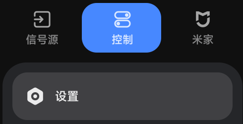](assets/screenshots/monitor-01-control.png)

本轮通过显示器接收的等价菜单键长按输入，实际走通了侧栏与设置入口。机身按键的位置和长短按组合未另作实拍；使用机身控制时，先通过设备自身入口进入同一“设置”页。

#### ② 在左侧选择“账号与安全”

用上下方向键移动到 **账号与安全**；在当前界面中它靠近列表底部。按向右键进入右侧设置区。

[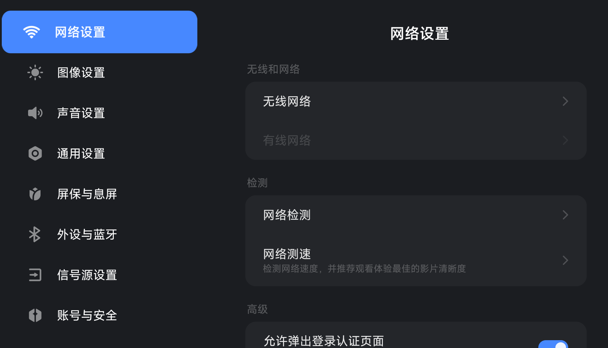](assets/screenshots/monitor-02-settings.png)

#### ③ 找到“ADB调试”，保持开启

在右侧用上下键找到 **ADB调试**。如果关闭，按确认键并按系统提示允许；如果已开启，保持当前状态即可。下图高亮行和右侧开关来自真实画面，账号已遮挡。

[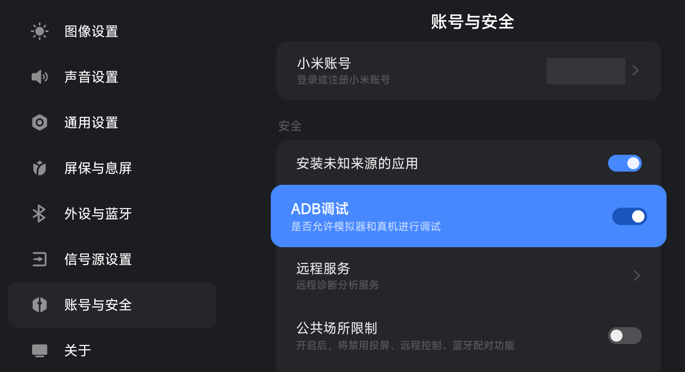](assets/screenshots/monitor-03-adb.png)

**只按本步骤处理 ADB。** 图中“安装未知来源的应用”等其他开关是原有状态，不要求跟着开启。此次拍摄未切换调试开关、未重置授权，也未修改调光参数。

#### ④ 连接电脑并确认授权

接好 USB 数据通道或使用同一可信局域网，再点软件 **自动寻找并连接**。首次出现 RSA 授权窗口时，在显示器选择允许；受信的自用电脑可按需勾选始终允许。此次设备已授权，没有为了截图撤销或伪造首次授权弹窗。

**连接时留意授权弹窗：** 如果电脑或显示器出现本次 ADB 连接的调试授权、管理员权限确认，请点击 **允许**（Windows 可能显示 **是**），再回到 APP 等待连接完成。弹窗是否出现取决于系统和设备当前的授权状态。

#### ⑤ 核对系统版本

回到厂商设置，在左侧选择 **关于**，核对页面中的系统版本。本轮显示为 **3.0.120.0**，完整系统标识为 **OS3.0.120.0.UFFMAMN**。查看版本不要求执行固件更新。

[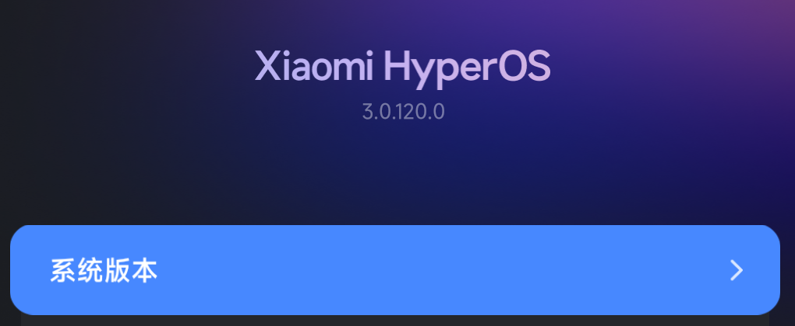](assets/screenshots/monitor-04-about.png)

以上是当前自用机状态下验证的菜单路径；没有将设备恢复为全新出厂状态重做首次开启流程。其他固件若页面不同，先核对版本和实际入口，不强行套用通用电视教程。

### 2.2 USB 还是网络？

| 方式 | 你需要做什么 | 常见误区 |
| :--- | :--- | :--- |
| **USB** | 接能传数据的线，到能承载显示器系统 ADB 的数据通道。Windows 设备管理器中应有正常的 MiTV-MFFU1 / Android ADB 接口。 | HDMI / DP 只传画面；充电线、接错 USB 口或驱动异常都不能建立 ADB。软件不切换 USB 角色。 |
| **局域网** | PC 和显示器处于同一可信网络；在显示器网络设置读取 IP。通常先用软件自动寻找，找不到再填高级连接。 | `HOST:PORT` 中的端口要用显示器实际开放值，不能假定一定是 5555；无线配对码流程需先按系统要求完成。 |

看到 `unauthorized`：看显示器屏幕，处理 RSA 授权。看到 `offline` 或未找到：检查 ADB 开关、数据线、网络和冲突程序。**不要通过结束所有未知 adb.exe 来碰运气。** 重启后 ADB 可能需要手动重新开启。

### 自动寻找的范围与手动后备

0.9.26 检查已连接的 USB/网络 ADB、广播的连接端口、成功记录及已知邻居。它会核对受支持设备；手机不当作显示器，配对端口不当作连接端口。同一台显示器的 USB 与网络入口合并；找到两台受支持设备时需要明确选择。

没有在第二台显示器或另一套局域网实测。陌生序列号、不同私有网段、多网卡邻居、动态广播端口、授权失败与多设备冲突已做模拟。路由器隔离、禁用广播、没有已知邻居或未广播的自定义端口仍可能找不到。

找不到时，展开 **高级连接**，在 **设备地址 / USB序列号**填自己的 USB 序列号或 `HOST:设备端口`，再点 **按高级参数连接**。**本机ADB服务端口**属于电脑上的 ADB 服务，默认/自动分配的 5041 不能照填为显示器端口；传统网络 ADB 只尝试已知邻居的 5555，不扫描整个网段。新式无线调试的配对需先完成系统配对。

[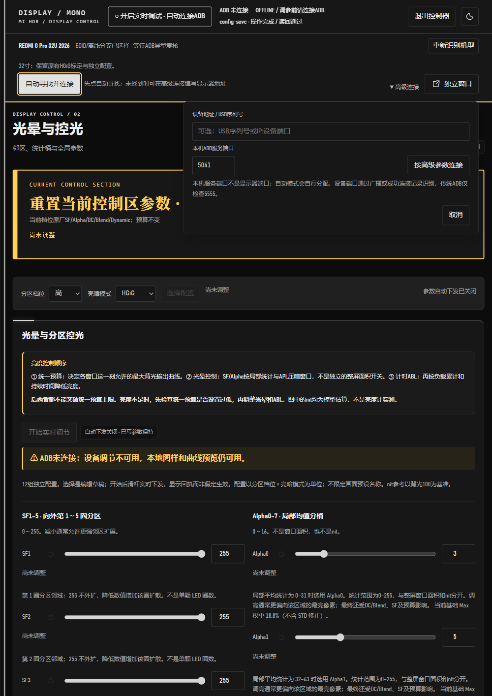](assets/screenshots/app-21-adb-advanced.png)

接口与限制依据 [Android ADB 文档](https://developer.android.com/tools/adb)和 [AOSP 无线 ADB 说明](https://android.googlesource.com/platform/packages/modules/adb/+/HEAD/docs/dev/adb_wifi.md)。本工具没有绕过 RSA 授权、开启 root 或更改网络隔离的功能。

**第 2 步完成：** ADB 调试已开启，数据通道已准备好；首次电脑授权在下一步连接时完成。

## 3. 解压、确认型号、选备份、连接

### 3.1 打开程序与选择型号

1. 将整个 ZIP 解压到一个新文件夹，例如你自己创建的工具目录。
2. 双击 **MI HDR Control.exe**。`启动控制器.cmd` 也是同一原生窗口的入口。
3. 先阅读 **开始使用前** 弹窗：简短风险、保管备份和正常退出方式。点 **知道了** 后进入型号选择。
4. 检查屏幕尺寸和分支，确认与实物相符，再点 **进入对应工作台**。不接设备只看界面时，可以展开 **未接入目标显示器？仅离线查看**。

[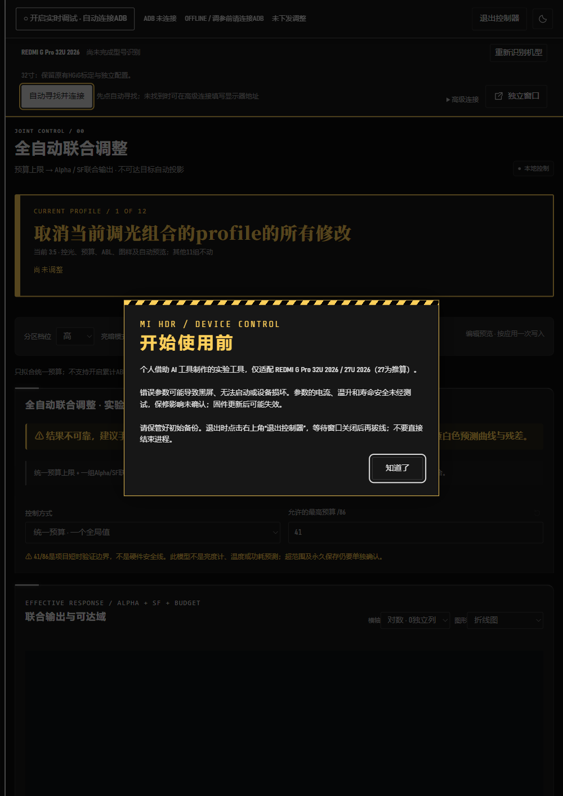](assets/screenshots/app-00-startup.png)

[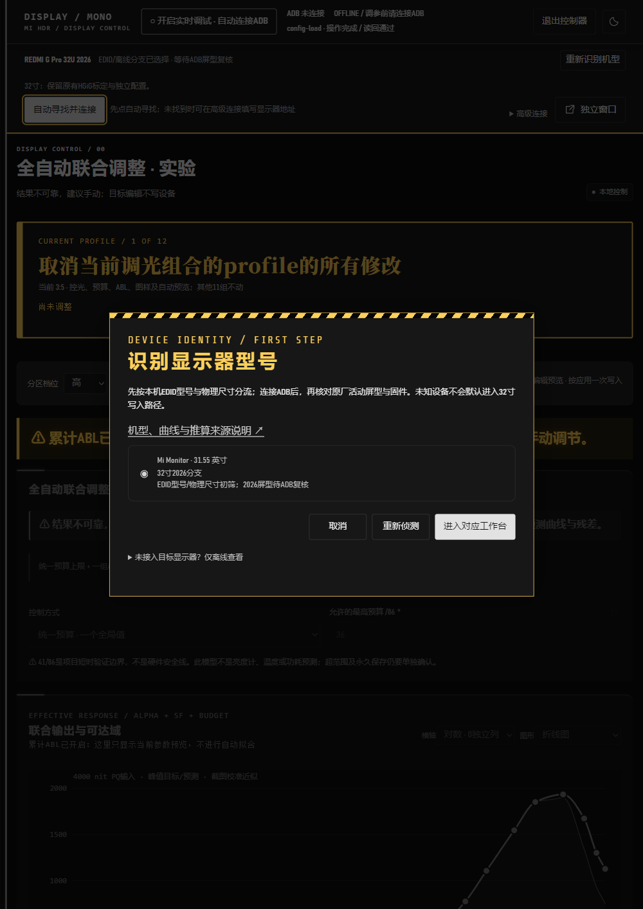](assets/screenshots/app-01-model.png)

**看什么：** EDID 只作初筛，不表示驱动已经匹配；连接 ADB 后还会检查活动屏型和固件。型号不对就停在这里，不要选一个相似型号继续。

**窗口和导航：** 0.9.26 默认按竖向 A4 比例打开，小屏会受工作区高度限制。窄窗左侧导航会自动隐藏；把鼠标移到最左边细条或点击细条，再选择模块。页面较长时向下滚动，右侧/底部读回区按当前布局排列。教程截图为 1000×1414 的实际界面无损 PNG，可点击原图放大。

### 3.2 选择初始备份位置

电脑备份为必选；可同时选择显示器副本，然后点 **保存选择**。备份位于便携目录内，另行复制保管好。不要把设备备份上传 GitHub。

[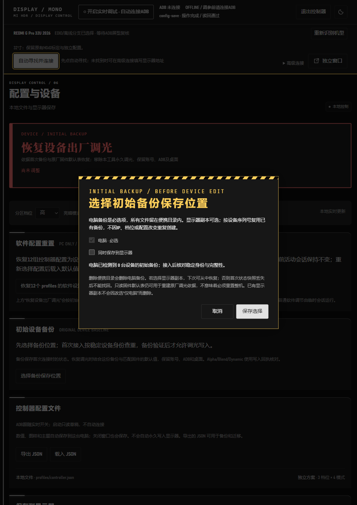](assets/screenshots/app-02-backup.png)

**看什么：** 这里先选择保存位置，实际接入后才创建或核对备份。备份保存首次连接时的设备状态，恢复时结合匹配固件的默认表使用。备份完成后的提示只有 **知道了** 按钮。

### 便携目录：备份和运行数据放在哪里

本机备份按 **当前解压目录**定位，运行时展开成完整路径。没有写死作者的盘符或安装目录，也不依赖启动时的工作目录。界面显示完整路径，便于找到文件。

| 内容 | 相对便携包的位置 |
| :--- | :--- |
| 初始设备备份 | `state/device-backups/DEVICE_KEY/initial-v1.json` |
| 控制器配置 | `profiles/controller.json`、`profiles/models/` |
| 本机准备的组件与模型 | `state/prepared/` |
| 拟合响应缓存 | `state/response-model/` |
| ADB 授权文件 | `state/android/` |
| WebView2 页面与缓存 | `state/webview/` |
| 应用日志与操作记录 | `logs/`、`experiments/` |
| 临时文件与图样记录 | `tmp/`、`captures/` |

移动或改名：先点 **退出控制器**，等待关闭，再移动整个便携目录。不要只移动 EXE；保留 `state` 和 `profiles`，备份、授权和设置会随包一起移动。新的公开包不含作者的这些个人数据。

**手动导出 JSON** 使用你在保存窗口里选择的位置，可以选在包内，也可以另存到你自己的目录。显示器上的副本位于设备内，由“同时保存到显示器”单独选择。

本次已把测试包改名并移动到含中文、空格的新目录，从包外工作目录启动，实际重新连接 ADB：原备份哈希相同、未重复创建，模型缓存仍可用，调光读回值未变。

### 3.3 建立连接与首次本机准备

1. 点上方 **自动寻找并连接**，留意电脑和显示器上的弹窗。出现 RSA 调试授权或本次 ADB 连接的管理员权限确认时，点击 **允许**／**是**。
2. 等待型号、活动屏型、固件与初始备份检查完成。第一次会从自己的显示器读取原件，在本机准备桥接相关组件、预算适配器及模型缓存。
3. 检查连接状态与错误信息。准备未完成、文件指纹不匹配或备份失败时，先处理提示，不继续调参。
4. 确认连接后，点顶栏 **开启实时调试 · 自动连接ADB**，等待调试就绪；再选 **分区档位**和**亮暗模式**，点 **选择配置**。三档 × 四模式共 12 组，先从自己已确认的组合开始。

[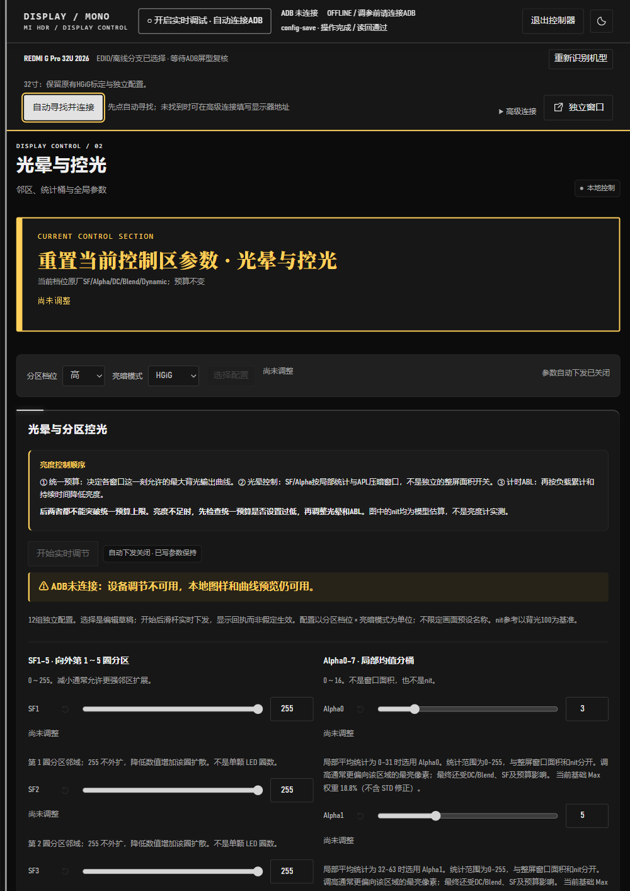](assets/screenshots/app-03-connect.png)

不用 AI、Ghidra、JDK 或编译器。首次准备产生的 `state/prepared`、初始备份、连接记录和日志是个人数据，不随下一次公开打包转发。需要手填地址时展开 **高级连接**，仅填你自己设备的 `HOST:PORT`。

**第 3 步完成：** 型号及固件检查通过，初始备份与本机准备完成，实时调试和当前配置就绪。

## 4. 选择组合，先只改一项

1. 确认顶栏 **实时调试**已开启、ADB 在线，型号与初始备份检查完成。
2. 选择 **分区档位**和**亮暗模式**，点 **选择配置**。这次只调当前组合，其他 11 组独立。
3. 点左侧 **光晕与控光 02**，记下准备改的那一项原值。先查[参数增减效果](modules.zh-CN.md#halo)，只做一次小幅比较；接口允许范围不代表经过安全验证。
4. 确认 **开始实时调节**的状态，再编辑数值框。当前版在已选组合中编辑光晕参数也会自动开启下发，不能把“编辑”当作一定只留在电脑的草稿。
5. 看下方 **下发序号 / 设备回执**和本次错误提示。星号表示偏离默认值，不能单独证明已写入。

[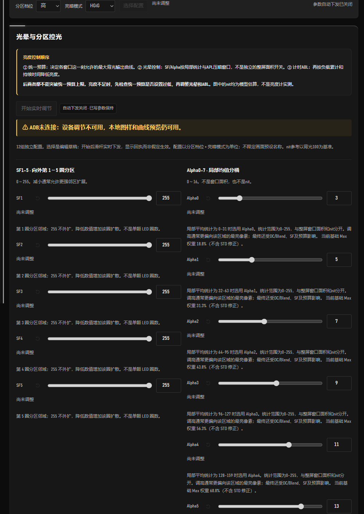](assets/screenshots/app-04-halo.png)

**完成标志：** 组合正确，只有预期的一项改变，有与本次操作对应的回执。想调大窗口时改用 [01 预算教程](modules.zh-CN.md#budget)；它需要另按 **应用统一亮度设置 · 一次写入**，和光晕实时滑杆的操作不同。

## 5. 短时比较图样，再看读回

1. 点 **HDR 图样 04**。先用 **窗口预览**、1 行 × 1 列，选择要比较的白窗面积和 **PQ 输入 nit**。
2. 检查 **时长秒**；0 表示不限时。首次比较设定短时显示，避免留下高亮大窗无人看管。
3. 点 **显示 HDR 图样**；修改后点 **更新图样参数**。同一次比较固定面积、位置、输入和显示器模式。
4. 看亮点、周围暗部、边缘和持续亮度是否符合自己的偏好。小窗更亮时，周围光晕通常也更明显。
5. 在右侧 **设置 / 驱动读回**看本次新鲜数据；也可到 **传感器与记录 05 → 读取传感器**。没有返回时保留“—”，不当作零亮度。

[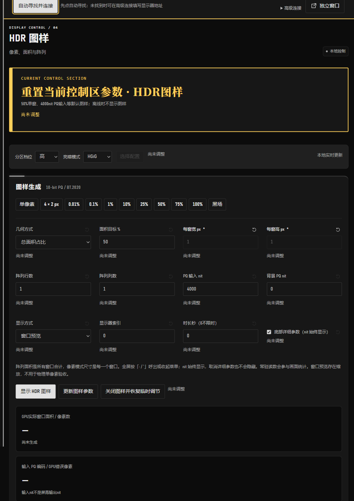](assets/screenshots/app-07-pattern.png)

**完成标志：** 图样与输入条件已记录，比较前后条件一致。输入 nit、模型参考 nit 和屏幕实测亮度分别看待。像素精确全屏、阵列和 GPU 回读见 [04 逐模块教程](modules.zh-CN.md#pattern)；驱动与温度读数见 [05](modules.zh-CN.md#readback)。

## 6. 结束临时会话，确认恢复

1. 停止编辑。到 **HDR 图样 04**，点 **关闭图样并恢复临时调节**，看回执；全屏可先按 `Esc` 返回。
2. 关闭顶栏实时调试，即 **关闭调试 · 恢复默认并断开**，等恢复与断开完成，再退出控制器。
3. 如果出现 **恢复/断开未确认 · 重试关闭**，保留错误信息，处理连接后重试，不因窗口消失就认定已恢复。

4. 最后点击 APP 右上角 **退出控制器**，等窗口自行关闭，再收线或关机。不要用任务管理器直接结束进程。强制结束会跳过正常保存、临时恢复和模块收尾，参数及租约状态可能来不及确认。异常退出后重新打开，核对当前读回并按恢复流程处理；不要只看窗口消失就认定设备已恢复。

**完成标志：** 临时恢复有成功回执，ADB 按操作断开。关闭 02 模块的实时按钮只暂停后续下发，已写值保持；它与结束整个临时会话作用不同。

已有常驻方案在 PC 接管时会暂停到本次开机结束；结束 PC 调试不会自动取消这一暂停。需要恢复常驻时，先确认临时会话结束，再重新保存，或等下次正常开机加载。各恢复按钮的范围见 [06 对照表](modules.zh-CN.md#restore-scope)。

## 7. 保留设置：先保存在电脑

### 7A. 日常方式：PC 草稿和 JSON

数值、图样、主题和自动调光目标会自动保存在电脑，界面左下角显示保存状态，无需再点保存。需要单独备份或迁移时：

1. 进入 **配置与设备 06**，点 **导出 JSON**。
2. 在 Windows **导出控制器配置** 窗口中选文件夹、填写文件名，点 **保存**。可以保存在便携目录外，也可以取消本次导出。
3. 在新包中点 **载入 JSON**，选择之前保存的文件，核对型号与组合。

这些操作只保存 PC 配置；显示器开机常驻需要另行永久保存。

[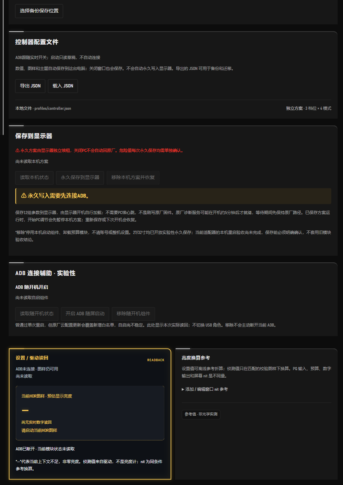](assets/screenshots/app-13-profiles.png)

**完成标志：** PC 文件已保存，导出文件另行保管；初始设备备份也单独保留。

### 7B. 可选：永久保存到显示器 · 实验性

仅在已理解风险、完成临时调节和恢复检查后使用。到 **配置与设备 06 → 保存到显示器**：

1. 重新连接，核对初始备份与全部 12 组配置。
2. 点 **读取本机状态**；确认目标组合和内容，再点 **永久保存到显示器**，阅读本次确认提示。
3. 核对当前启动周期的方案摘要和新鲜心跳。保存成功仅证明本次保存，不能替代重启验收。
4. 撤销时点 **移除本机方案并恢复**，等待模块、租约和参数核对。需要恢复本工具相关的全部调光路径时，用页首 **恢复设备出厂调光**。

当前适配器完整重启验收仍未完成，`boot_verified=false`；普通使用不要求为教程重启试验。永久方案关闭电脑后仍可能运行，系统更新也可能使其失效。**恢复设备出厂调光**只处理本工具涉及的调光，不重置账号、桌面或整机系统。完整操作和异常范围见 [06 保存与恢复](modules.zh-CN.md#save-restore)。

## 8. 下次打开，或换新版便携包

- 下次打开先核对型号、ADB 状态和当前组合，再开启调试；启动读取 PC 草稿不等于已连接或已下发。
- 升级前退出旧控制器、导出 JSON、另存初始备份。在新目录解压新版，按流程重新连接和准备；不要整目录复制旧 `state`、缓存及日志。
- 固件或文件指纹不匹配时先停下，保留错误提示；不改校验值绕过适配。
- ADB `unauthorized` 看显示器授权弹窗；`offline` 检查开关、线缆、网络和冲突程序，重启后可能要重新开启 ADB。

**到这里完成一次使用。** 之后按需要查[逐模块详解](modules.zh-CN.md)，无需每次重读首次连接教程。作者生成后续公开包的规则见[自用到公开](RELEASING.zh-CN.md)。
