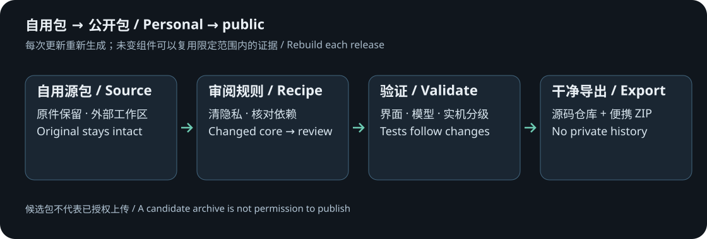

# Personal package → public release

[中文](RELEASING.zh-CN.md)

Keep personal configuration and research originals in the private package. Generate public files with the external release tool; never zip or commit the personal directory directly. 0.9.26 is the current reviewed input. Later revisions use the same process, with review when unknown changes appear.



## Outputs and commands

- **repository/**: clean source, documentation, licenses and build rules for a fresh Git history.
- **portable/** and ZIP: the runnable end-user package, required notices/source, Python, ADB and project helpers.
- **private-audit/**: original fingerprints, diffs, tests, identities and rollback data; never published. A binary deletion patch may contain the deleted original bytes.

1. Exit the old program and run `release-tools/release.py prepare --source SOURCE --output OUTPUT --version VERSION` in a fresh work area.
2. Source remains unchanged. The tool checks structure/protected components, copies approved files and applies the reviewed public transformation.
3. Runtime state, personal profiles, identifiers, keys, addresses and paths are excluded. So are monitor-menu features, the old helper JAR, Frida, vendor modules/extracted code and complete factory calibration/configuration.
4. Keep current dimming functionality, the independent bridge and owner-side preparation. Render versioned documentation. Unknown native/interface/dependency/resource changes require review, not an old file silently copied over new code.
5. Run `release-tools/release.py check --candidate OUTPUT/portable` for static privacy, scope, notices, links, syntax and default-value checks. Run the preparation and native lifecycle tests separately as described below.
6. Complete the relevant change-tier tests below and record the current component fingerprints.
7. Use `package` to create a review ZIP/manifest. Missing publication decisions or unresolved gates keep `release_ready=false`.
8. Create a new Git repository only from **repository/**. Public credit, license/palettes/experimental status and GitHub upload require a separate publication decision.

## Change-tier validation

| Change | Minimum revalidation |
| --- | --- |
| Docs/translations/CSS/labels | Links, images, layout, paired language facts, privacy/theme rules and clean startup |
| Window/input/lifetime | Native window, scaling, module opening/closing and owned-backend shutdown |
| Prediction/fitting/reference/math DLL | Numeric comparison with the current reference and limits; not a claim of optical validation |
| JAR/JNI/device helpers/budget objects/persistence | Readback, bounded writes, lease expiry, load/unload, save, reboot and baseline restoration |
| Model/driver/kernel/firmware layout | Stop old write adaptation; research and fingerprint a new supported input |
| Fonts/images/third-party binaries | Provenance, exact version, permissions/notices/source and compatibility |

An unchanged device component can retain its specific accepted evidence during a UI-only update; the new UI still needs testing. Changed APKs also need signing and previous-version ownership migration. Do not automatically replace signing keys or publish private keys/ADB authorizations/backups.

## Cache and maintenance rules

Original-input and generator/object/layout fingerprints jointly determine cache reuse. Generation changes invalidate old cache. Preparation occurs on the user's own PC, with completion published last. No author-generated vendor KO/ELF/instruction/XML/calibration cache is preinstalled.

Chinese/English documents are paired deliverables. Update compatibility, defaults/ranges, button meanings, recovery scopes, EOTF/highest-input explanations and evidence with the actual changes. Keep number/color palette labels and upstream font permissions. Update provenance/notices/corresponding source when dependencies change.

Retain historical failures and distinguish obsolete fixtures from current defects. Do not remove safety gates or replace assertions with unconditional success to obtain a green test count.

Suggested GitHub settings: main branch; clearly experimental/dimming-only description; Issues, Discussions, Wiki and Projects may be disabled to match the no-maintenance policy. No automatic publishing, inherited private remotes or upload credentials.

## Executable checks

`check` inspects scope, notices, privacy, links, Python syntax and defaults. Run `tests/test_public_release.py` separately for the current contract suite, and `release-tools/smoke_desktop.py --candidate OUTPUT/portable --report REPORT.json` for native startup/close. Publishers with private original-input fixtures can set `MI_OWNER_INPUTS` to include preparation tests. Static checking never performs monitor writes.

## Windows commands

Run from a reviewed complete portable package. SOURCE is the complete personal input; OUTPUT must be a fresh external directory; VERSION is the candidate version. The source repository omits the full Python/ADB runtime. Supply a complete personal or portable package as input rather than fetching anything from the author's private paths.

```powershell
.\tools\python\python.exe .\release-tools\release.py prepare --source "SOURCE" --output "OUTPUT" --version "VERSION"
.\tools\python\python.exe .\release-tools\release.py check --candidate "OUTPUT\portable"
.\tools\python\python.exe "OUTPUT\portable\tests\test_public_release.py"
.\tools\python\python.exe "OUTPUT\portable\tests\test_documentation.py"
.\tools\python\python.exe .\release-tools\smoke_desktop.py --candidate "OUTPUT\portable" --report "REPORT.json"
.\tools\python\python.exe .\release-tools\release.py package --candidate "OUTPUT\portable"
```

Checks also scan project-native ELF build paths. `redact_debug_paths.py` anonymizes only non-loaded debug strings at identical lengths and requires every PT_LOAD byte/header to stay unchanged. Identity data in runtime sections requires review, not executable-string replacement. Metadata-only changes still receive new file fingerprints and scoped validation. Included event/JNI/service-argument helpers retain their source; static-runtime notices are in LICENSES.

Git attributes preserve exact bytes so checkout line-ending conversion cannot silently invalidate component evidence. Exit other versions before hardware tests. Record boot autostart, ADB readback and uninterrupted sustained operation separately.

## Confirmed decisions and illustrated-document maintenance

- English applies to the README/guides, not an English GUI. The release level is experimental preview; numeric palettes and open fonts remain.
- Render paired documents from `release-tools/templates/`, including the research chapter. Do not update only an exported copy.
- Preserve the actual screenshot version; a version-number change does not turn old screenshots into new captures. Recapture controls whose labels/semantics change.
- Research figures use `docs/assets/research/model-experiments.json`. Recollect with a matching prepared runtime after model changes; retain the distinction between digital output and optical measurements.
- Keep raw captures and identifiers outside the export. Published images must exclude accounts, SSIDs, serials, addresses and private paths.
- Credit is MI HDR Control contributors; original prose/figures use CC BY-NC-SA 4.0. Original software/functional UI code is GPL-2.0-only; upstream terms remain unchanged. Upload still requires explicit authorization.

## Confirmed first-connection and capture rules

The current 32U route is Control → Settings → Account & security → ADB debugging; check firmware under About. Do not automatically insert an unverified model/build-number tapping sequence into later guides. Crop/privacy-mask only; no AI UI reconstruction or changed switch/readout labels. Public captures and source fingerprints/crop-mask regions are recorded in `docs/assets/screenshots/provenance.json`; raw private frames remain outside exports.

`pending_decisions=[]` means license/palette/document scope decisions are confirmed. `release_ready=false` and `publication_authorized=false` retain the separate upload-authorization boundary. Inherited fixture failures, inferred 27-inch support and incomplete uninterrupted reboot acceptance remain known limitations, not passed tests.

## Fixed tutorial and capture rules

- Keep `guide.zh-CN.md` / `guide.en.md` sequential: preparation, ADB, extraction, backup, connection, one temporary change, pattern/receipt, restoration and PC save, followed by optional persistence. `modules.*.md` explains 00/01/02/04/05/06 by purpose, operations, effects, application and restore scope.
- All APP tutorial captures use dark MONO (素·黑白), native lossless PNG and original pixels. Converting or enlarging a blurry JPEG does not improve source detail. Use separate value/action views when useful; keep labels and order faithful to the real UI.
- Keep coloured main-window captures in the README footer gallery, outside operation steps. Match the actual palette count and display names.
- Preserve genuine offline states and unavailable readings. Do not fabricate RSA prompts, connection success, temperature or write receipts. Monitor menus permit cropping/privacy masking only. Unchanged pages from the same firmware may be reused with their source/version identified.
- After image/data/tutorial changes, synchronize `provenance.json`, both languages, old Chinese entry points and templates. Also run `tests/test_documentation.py` for image format/appearance, legend-to-data correspondence, the two guide routes and template consistency. This check does not connect to a monitor.

## Concrete boundary from 0.9.26

The policy binds pristine 0.9.26 fingerprints to reviewed overlays. Unknown code, native binaries or assets return `REVIEW_REQUIRED` before export. Even a minor style update is diff-reviewed before refreshing its fingerprint/overlay, version and captures; never silently replace newer features with older code.

Run the maintained Python suite, `tests/test_release_0926.js`, public-contract and documentation checks. Model checks require the publisher's own locally prepared inputs; missing fixtures must be reported, not filled by distributing the author's derived cache. ABL changes cover full off-state, one-snapshot submission, invalidated/late results, fixed/cyclic/unresolved outcomes, draw-only spacing and XY/ZY consistency. ADB changes cover foreign serials, private IPv4 ranges, connect/pair ports, authorization, duplicate transports and multiple devices. Simulations are not cross-device acceptance.

Keep the portrait-A4 native default. Tutorial captures are dark MONO 1000×1414 PNGs. Palette views belong at the README footer, preferably in parameter areas away from concentrated notices; do not delete warnings for presentation. Refresh provenance after replacing images. Use the APP Exit button; automated lifecycle checks use the app-owned shutdown API, with actual native-button/title-close checks recorded separately.

### Full development regression entry

From a portable directory with local components prepared, run:

```powershell
.\tools\python\python.exe .\scripts\run_unit_tests.py
node .\tests\test_release_0926.js
node .\tests\test_ui_followup.js
```

Without model fixtures, the runner explicitly exits 2 rather than reporting success. A publisher may set `MI_OWNER_INPUTS` to their own 25 verified original inputs for local preparation, without connecting/writing the monitor. Node.js is a publisher-side regression dependency, not an end-user runtime dependency. GPU, public-contract and documentation checks retain their separate entries.

Parallel-cache changes require serial equivalence, cache reuse and samples across model/tone/level contexts. Each worker owns an emulator; do not share an engine between threads. Record cold, warm and fit-refinement time separately. Export changes require native Save As, a chosen location, Unicode paths, Cancel and normal-exit checks; a browser download does not validate the native picker.

## GitHub setup and later updates

Repository: [https://github.com/Korhii/MI-HDR-Control](https://github.com/Korhii/MI-HDR-Control). This is a personal-use experiment shared as-is. Issues, Pull Requests, Discussions, Wiki and Projects are disabled; maintenance and contribution acceptance are not promised. Normal owner commits to `main` remain possible, with force pushes and deletion blocked. Published `v*` tags are not overwritten or deleted.

**Public package checks** runs on main updates and manually from Actions. It has read-only contents permission, no secrets, no monitor access, no derived-firmware preparation and no automatic release. Full model/GPU/device checks remain local and change-scoped.

For each update: (1) exit the old controller and choose a new SOURCE, external OUTPUT and VERSION; (2) prepare the clean exports and complete relevant checks/docs/CHANGELOG/license updates, reviewing changed fingerprints; (3) explicitly approve that candidate and package it; (4) commit only the clean repository tree and wait for Actions; (5) use Releases → Draft a new release, create `vVERSION` on the intended commit, mark pre-release and upload the portable ZIP/checksums using the [notes template](release-notes-template.md); (6) download/check the draft assets, publish, then verify public downloads. Keep previous tags and artifacts unchanged. The automatic Source code ZIP lacks the full runtime.

```powershell
.\tools\python\python.exe .\release-tools\release.py approve --candidate "OUTPUT\portable" --repository "https://github.com/Korhii/MI-HDR-Control" --tag "vVERSION"
.\tools\python\python.exe .\release-tools\release.py package --candidate "OUTPUT\portable"
```

Replace SOURCE/OUTPUT/VERSION. Approval records one owner decision and never uploads; a new prepare returns to an unapproved candidate. Source commits do not update existing release assets. There is no automatic updater. Git identity is repository-local and uses the public handle/noreply address.
