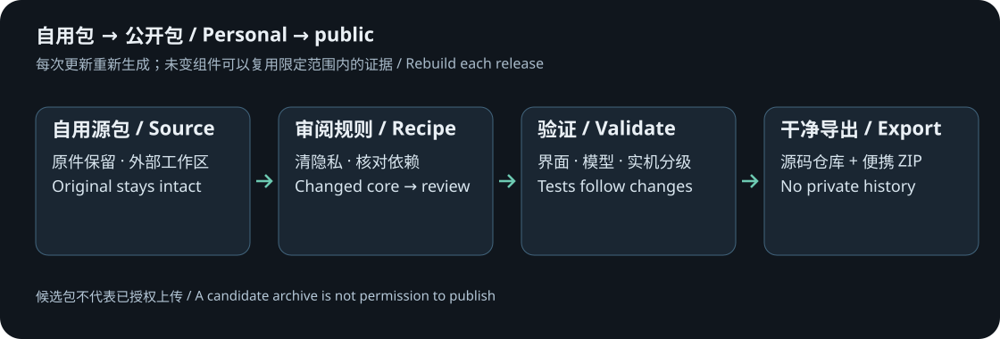

# 自用版本到公开版本：规则与操作

[English](RELEASING.en.md)

## 原则

自用目录保留全部个人配置和研究原件。公开内容通过外部发布工具生成，禁止直接把自用目录压缩或 `git add` 上传。0.9.26 是当前已审阅输入，后续小版本使用同一流程；脚本不承诺盲目接受任何未知改动。



## 两类输出

- **repository/**：供新建 Git 仓库的干净源码、文档、许可与构建规则，不继承自用 Git 历史。
- **portable/** 与 ZIP：供普通使用者解压运行；含 Python、ADB、项目组件、声明和所需配套源码，不含厂商派生缓存或个人数据。
- **private-audit/**：原件指纹、差异、测试、签名/设备身份和回滚资料，留在作者电脑，不放到 GitHub。二进制差异补丁可能含被删除的原件，不能把“删除补丁”当成可公开文件。

## 每次发布

1. 完全退出旧程序，确定待发布版本，在新工作目录运行 `release-tools/release.py prepare --source SOURCE --output OUTPUT --version VERSION`。
2. 脚本读取源版本，检查结构与受保护组件，生成副本，执行已审阅的公开化规则。它不改 SOURCE。
3. 去掉运行目录、账号/地址/密钥/个人路径，重置个人 profiles，排除显示器菜单功能、旧无授权 JAR、Frida、厂商 KO/提取模型、整份原厂配置和 gamma。
4. 替换为独立桥接和本机准备逻辑，保留当前版的调光功能；输出文档按版本渲染。未知原生代码、接口、依赖或新资源进入 review 分支，不自动沿用旧覆盖文件。
5. 运行 `release-tools/release.py check --candidate OUTPUT/portable`，检查文件范围、许可、私有文件、链接、Python 语法与默认值。另运行 `tests/test_public_release.py` 做当前专项检查，以及 `release-tools/smoke_desktop.py --candidate OUTPUT/portable --report REPORT.json` 做原生启动/退出检查；有原厂输入的发布者再用 `MI_OWNER_INPUTS` 环境变量运行本机准备测试。静态 check 不会自动执行实机写入。
6. 按下表补足变更对应的测试。实机数据记录本次构建和组件指纹，不能只沿用版本号或旧“通过”标签。
7. 用 `package` 生成候选 ZIP、清单与报告。未确认发布决定或存在未解决门禁时保留 `release_ready=false`；候选包用于审阅，不等于可上传。
8. 仅从 `repository/` 建立新仓库。署名、数字配色、实验预览级别与分层许可已确定；创建仓库和本次首发已获明确授权；后续版本仍单独批准。

## 变更与复验

| 更新内容 | 最少复验 |
| --- | --- |
| README、翻译、普通 CSS/标签 | 链接/图片、排版、语言对应、隐私与主题规则、解压启动 |
| GUI 生命周期、输入与窗口 | 原生窗口、缩放、打开/关闭模块、退出时后台收尾 |
| 预测、拟合、参考数据、数学 DLL | 当前参考输出的数值对照、边界与模型限制，不能把模型一致性写成光学测量 |
| JAR、JNI、设备 helper、预算对象或常驻启动 | 读回、受限临时写入、租约回退、加载/卸载、保存、重启和原始状态恢复 |
| 型号、驱动、内核、固件布局 | 停止复用旧写入方案，重新适配并增加原厂输入指纹 |
| 字体、图像、第三方 DLL/APK/运行时 | 许可、来源、版本、对应源码/声明及兼容性；未获明确依据不直接带入 |

界面小修可以保留未变设备组件的已验证记录，但新界面自身仍要测试。APK 变化还涉及安装包签名和旧版本所有权识别；不要自动重新生成签名密钥。私钥、ADB 授权、设备备份和作者本机路径不进入仓库。

## 生成物与缓存

原厂文件与生成规则同时计入缓存指纹。更新生成器、对象或布局会使旧缓存失效；首次连接从使用者自己的设备重新准备。缓存完成标记最后发布；失败不假称已准备。新版本不预装作者生成的 KO、ELF、指令块、XML 或用户校准。

## 文档与许可维护

中英文文件是配对交付物。支持表、默认值、范围、按钮名、恢复语义、EOTF/10000 nit 说明及验证状态随真实变化更新。字体保持数字/颜色名；保留开放许可，不把非商业定位变成额外限制。每次更新依赖时更新 `third_party/provenance.json`、许可与配套源码，不只改 requirements 版本。

源码镜像不使用“已完成旧版实机验收”冒充当前构建；历史测试失败也保留原文并分类。缺失或不适用的旧夹具应单独说明，不能为了全绿而删安全门禁或改成永远成功。

## GitHub 设置建议

项目说明注明 Windows、仅调光、32U 实测范围与 27U 推算。默认主分支 main；Issues、Discussions 和 PR 保持开放供评论、纠错和交流，Wiki、Projects 关闭；不承诺维护、回复、修复或合并。不开自动发布，不继承私用 remotes，不配置上传密钥。统一署名 MI HDR Control contributors；原创文档/图表为 CC BY-NC-SA 4.0，程序与功能性界面代码为 GPL-2.0-only，第三方保持原许可。本次首次上传已获作者明确授权；后续每次发布仍需单独批准。

## Windows 命令

在已审阅的完整公开便携包中运行。SOURCE 指向待发布的完整自用包，OUTPUT 是源目录之外的新目录，VERSION 填本次候选版本，例如 0.9.26-public-preview.2。源码仓库不含整套 Python/ADB 运行时；配合完整自用包或完整便携包作为输入，不从作者私有目录拉取依赖。

```powershell
.\tools\python\python.exe .\release-tools\release.py prepare --source "SOURCE" --output "OUTPUT" --version "VERSION"
.\tools\python\python.exe .\release-tools\release.py check --candidate "OUTPUT\portable"
.\tools\python\python.exe "OUTPUT\portable\tests\test_public_release.py"
.\tools\python\python.exe "OUTPUT\portable\tests\test_documentation.py"
.\tools\python\python.exe .\release-tools\smoke_desktop.py --candidate "OUTPUT\portable" --report "REPORT.json"
.\tools\python\python.exe .\release-tools\release.py package --candidate "OUTPUT\portable"
```

发布检查同时扫描项目原生 ELF 中的作者调试路径。`redact_debug_paths.py` 只对非装载调试字符串作等长匿名化，要求每个 PT_LOAD 字节和头不变；运行时代码含有身份信息时停止审阅，不能直接替换执行段字符串。原生组件即使只清理调试元数据，也记录新文件指纹与验证范围。源码随附的 event helper、JNI 与服务参数 helper 一并保留；静态运行库声明见 LICENSES。

Git 属性保留原始字节，避免检出时换行转换使组件指纹失效。实机复验前退出其他版本，单独记录“开机自动运行”“ADB 回读”和“无干扰持续运行”，不能用其中一项替代全部。

## 本次已确认的规则与图文维护

- 英文范围是 README 与文档；不要求开发英文软件界面。首发为实验预览，现有数字配色与开放字体保留。
- 新版必须从 `release-tools/templates/` 渲染中英文 README、教程和研究页，不能只改导出结果而遗漏模板。
- APP 截图标注实际截图版本；只改包版本号时不自动把旧截图称为新版实拍。按钮或恢复语义变更时补拍对应模块。
- 研究图来自 `docs/assets/research/model-experiments.json`。模型变化后用匹配且已准备的本机运行目录重新采集，再同步双语图；旧数字不能冒充新版本结果。
- 截图原件和设备标识留在外部私有工作目录。公开图仅保留必要界面；不得把账号、SSID、序列号、地址或私有路径写进图片。
- 原创文档/图表及独立素材为 CC BY-NC-SA 4.0，程序与功能性界面代码为 GPL-2.0-only；第三方保持原许可，不自动上传。

## 已确认的初次连接与截图规则

当前 32U 系统的实拍路线是“控制 → 设置 → 账号与安全 → ADB调试”；版本在“关于”核对。不要把未验证的连按型号/版本号流程自动写进新版本教程。截图只裁切、遮挡隐私，不 AI 重绘，不修改开关或读数字样。公开图片与来源指纹、裁切/遮挡坐标记录在 `docs/assets/screenshots/provenance.json`；原始含隐私帧留在发布目录之外。

`pending_decisions=[]` 表示本轮许可、配色和文档范围已确认；`release_ready=false` 与 `publication_authorized=false` 保留给导出时尚未批准的候选。旧版夹具失败作为历史证据保留；当前维护后的回归单独记录。27 寸推算及常驻重启未完整验收继续列为已知限制。

## 教程与截图的固定发布规则

- `guide.zh-CN.md` / `guide.en.md` 保持第一次使用的顺序全链路：准备、ADB、解压、备份、连接、单项临时调节、图样/回执、恢复、PC 保存，最后才是可选常驻。`modules.*.md` 按 00/01/02/04/05/06 展开用途、操作、参数效果、应用方式与恢复范围。
- 所有 APP 教程截图固定为暗黑 MONO（素·黑白），使用原生无损 PNG，保留原始像素，不把模糊 JPEG 转成 PNG 或放大冒充清晰度。必要时增加数值区/应用区的分步截图；按钮名和操作顺序与真实界面一致。
- 彩色主界面截图集中在 README 末尾的配色展示，不插进操作步骤。配色数量、显示名与实际界面同步。
- 设备离线就保留离线提示和不可用读数；不为教程伪造授权弹窗、连接成功、温度或写入回执。显示器菜单图仅裁切和遮挡隐私，未变化的同固件页面可复用，来源与版本继续标明。
- 更新图片、数据或教程后，同步 `provenance.json`、两种语言、旧中文入口与模板；另运行 `tests/test_documentation.py`，检查图片格式/主题、图例对应数据、双路线链接及模板一致性。该检查不连接显示器。

## 0.9.26 起的具体执行边界

- 当前策略绑定 0.9.26 原件指纹与已审阅覆盖文件；未知代码、原生组件或资源变化先返回 `REVIEW_REQUIRED`，不静默套用旧代码。普通样式小修也先比较差异，再更新对应指纹/覆盖及版本；确认保留新功能后重新导出。
- 先跑当前 Python 套件、`tests/test_release_0926.js` 与公开版/文档专项。模型测试需要发布者自己的本机准备输入；无夹具时明确标记不适用，不能分发派生缓存来凑通过。
- ABL 改动须检查关闭整区不可用、快照一致、旧结果失效、稳定/循环/未收敛、时间间隔仅影响绘图、XY/ZY 与实际参数一致。
- ADB 改动至少覆盖陌生序列号、不同 IPv4 网段、配对/连接端口、未授权、USB+网络同机去重与多设备选择。没有跨设备实测就明确写模拟，不声称各个局域网都能自动找到。
- 默认原生窗口竖向 A4。教程暗黑 MONO，PNG 1000×1414；配色图放在 README 末尾，使用真实 ADB 在线、实时调试关闭的 APL与ABL控制页首。构图和 UI 大小参考用户确认的示例；当前为 885×1454 视口、100% UI、原生 2× PNG。只遮挡连接地址，不改写连接状态或曲线。更新配色图也同步来源记录和图片指纹。
- 正常退出用 APP 按钮；自动化启动测试使用本程序的 shutdown 接口，不结束未知进程。原生按钮/标题栏关闭由真实 UI 验证另记。

### 完整开发回归入口

发布者在已经完成本机准备的便携目录运行：

```powershell
.\tools\python\python.exe .\scripts\run_unit_tests.py
node .\tests\test_release_0926.js
node .\tests\test_ui_followup.js
```

`run_unit_tests.py` 在缺少模型时明确退出 2，不会把缺夹具当作通过。也可先将 `MI_OWNER_INPUTS` 指向自己保存的 25 份已核对原厂输入，由脚本仅在本机准备；它不连接或写入显示器。Node.js 仅用于发布者的 JavaScript 回归，不是普通用户的运行依赖。GPU、公开版和文档检查仍按各自入口运行。

并行缓存改动要对照串行结果、缓存重用及不同型号/模式/档位抽样；每个工作进程独立持有模拟器，不用多线程共享引擎。冷缓存、热缓存和拟合细化耗时分开记录。导出 UI 改动要在原生窗口验证选位置、中文路径、取消及正常退出，不用浏览器下载成功替代原生另存验收。

## GitHub：当前设置与以后更新

仓库为 [https://github.com/Korhii/MI-HDR-Control](https://github.com/Korhii/MI-HDR-Control)。定位是个人自用实验、顺便分享：Issues、Pull Requests 和 Discussions 开放，供反馈、评论和提交改动；不承诺回复、维护、更新、修复或合并。Wiki 和 Projects 关闭。`main` 禁止强制推送和删除，作者可以直接提交普通更新；`v*` 版本标签发布后不覆盖、不删除。

GitHub 的 **Public package checks** 在 main 更新和 Pull Request 时执行，也可在 Actions 手动运行。它只有源码读取权限，不含密钥、不连接显示器、不生成固件缓存、不自动发布。完整模型、GPU 和实机测试仍由发布者按本次改动在本机完成。

### 下一次小版本：六步

1. 正常退出旧控制器，保留自用目录及初始备份。明确 SOURCE、VERSION 和源目录外的新 OUTPUT；例如 VERSION 使用 `0.9.27-public-preview`，每次使用新版本，不覆盖已发布 ZIP 或标签。
2. 按本文命令生成干净 `repository/` 与 `portable/`，完成对应回归，更新中英文文档、实际截图、CHANGELOG 和依赖许可。代码或依赖变化触发 `REVIEW_REQUIRED` 时先审阅差异，再更新已审阅策略；不绕过指纹检查。
3. 明确决定发布后，执行下方 **approve**。它只记录这一次授权，不联网、不上传；每次 prepare 仍生成未批准候选。然后 package 得到 ZIP。
4. 只在独立的源码仓库中更新 `repository/` 的干净内容。使用 GitHub Desktop 提交、推送普通 commit，或使用 Git 命令；不要把自用目录、private-audit、基线归档或差异补丁拖进去。等 Actions 检查通过。
5. 在 GitHub **Releases → Draft a new release** 中选择当前 main 的提交，新建与 VERSION 一致的 `vVERSION` 标签，保留标题中的“实验预览”，不勾选 **Set as a pre-release**，勾选 **Set as latest release**。按 [发布说明模板](release-notes-template.md) 填变化、测试和已知限制，上传完整便携 ZIP 与校验文件；先保留草稿。
6. 下载草稿附件核对大小与校验值，确认下载的是便携 ZIP，最后点 **Publish release**。发布后再核对匿名可访问的下载页。GitHub 自动生成的 Source code ZIP 不替代便携包。

```powershell
.\tools\python\python.exe .\release-tools\release.py approve --candidate "OUTPUT\portable" --repository "https://github.com/Korhii/MI-HDR-Control" --tag "vVERSION"
.\tools\python\python.exe .\release-tools\release.py package --candidate "OUTPUT\portable"
```

把 VERSION、SOURCE、OUTPUT 换成自己的本次值。仅更新源码不会自动更新已发布附件；程序没有自动更新服务。GitHub 提交只对本仓库设置公开昵称与 noreply 邮箱，不修改电脑的全局 Git 身份。

GitHub 的 Latest 用作最新下载入口。当前版本标题和项目成熟度仍为“实验预览”；GitHub 不允许 Pre-release 同时标为 Latest，因此此渠道不使用 Pre-release 复选框。核对仓库侧栏出现版本链接与 Latest，并确认 `releases/latest` 指向本次版本。发布标记的规则见 [GitHub 文档](https://docs.github.com/en/rest/releases/releases#update-a-release)。
