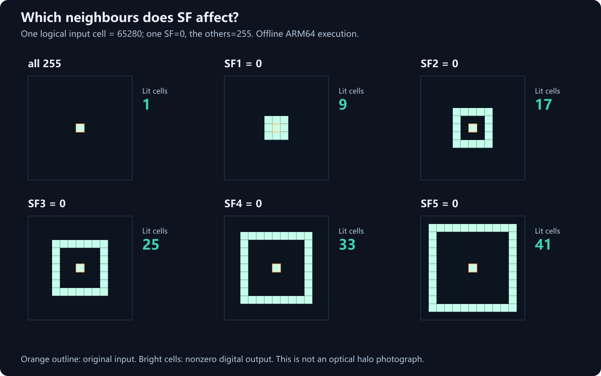
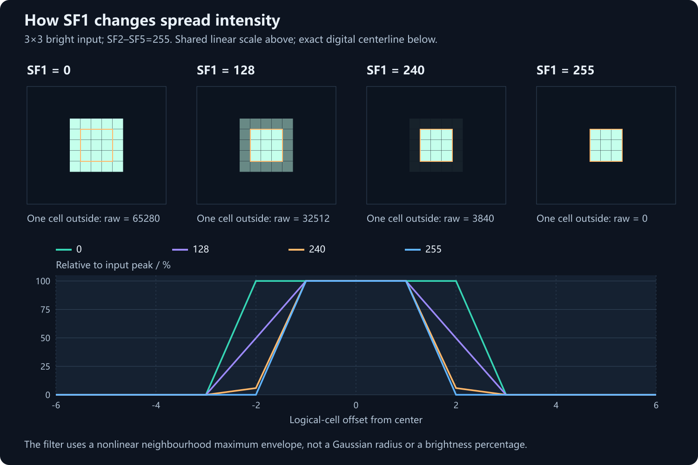
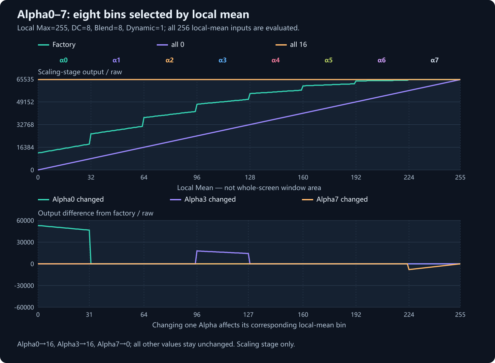
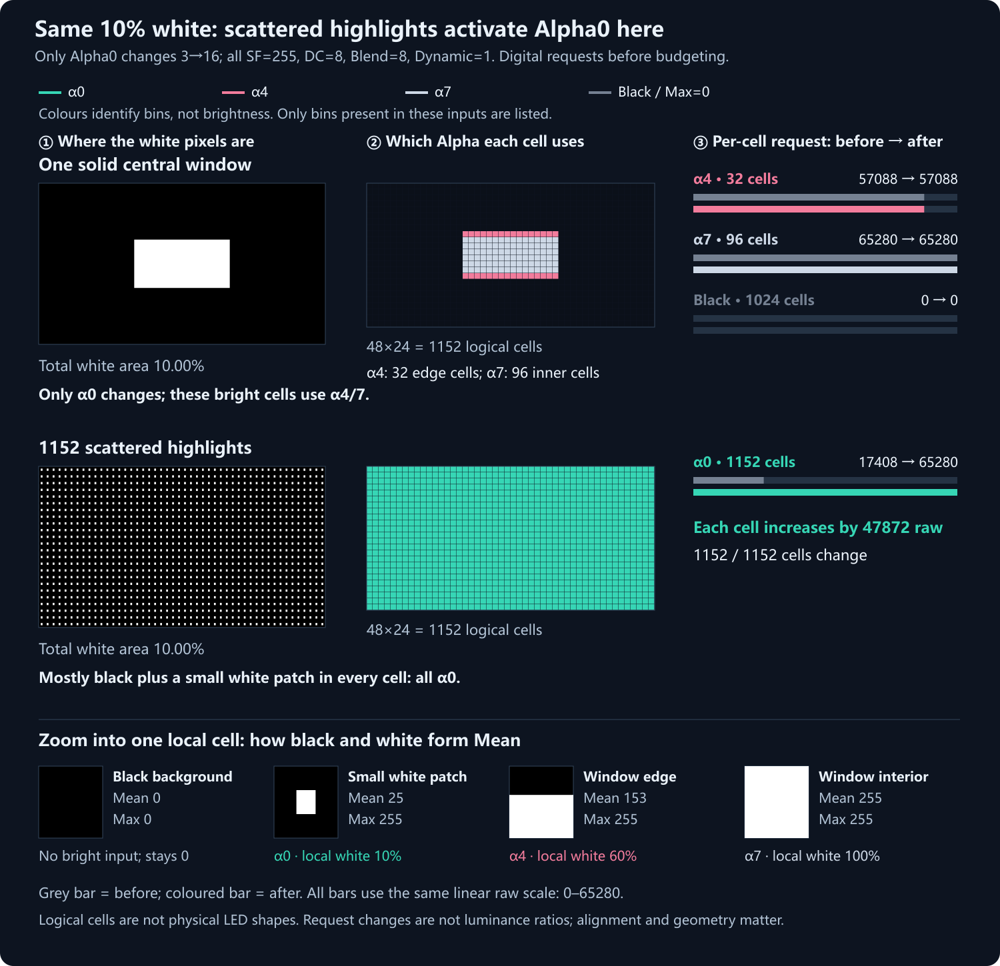
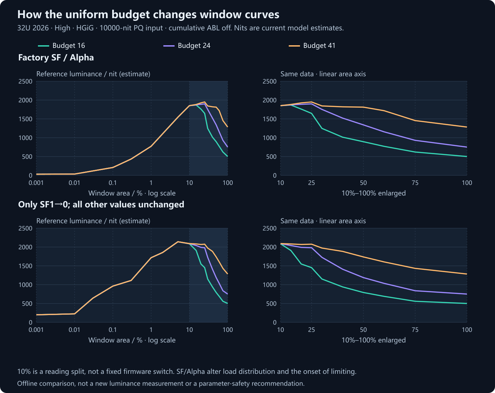
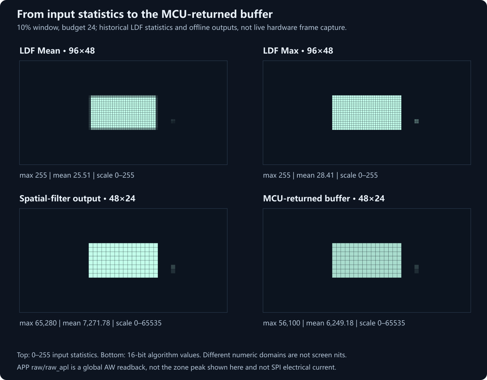
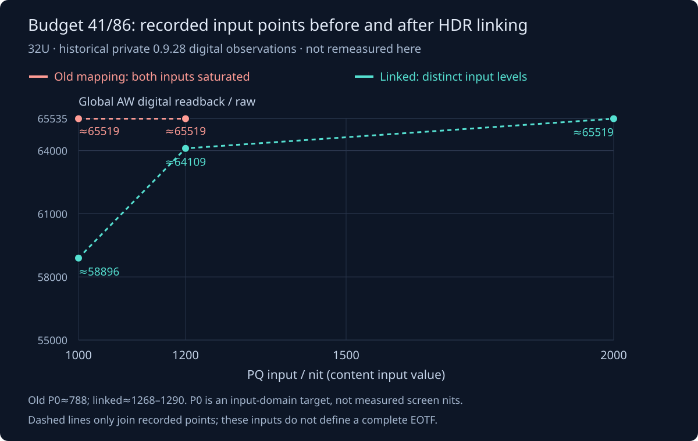

# Dimming research notes

[简体中文](RESEARCH.zh-CN.md) · [Home](../README.en.md) · [Practical guide](guide.en.md)

This record separates **offline digital execution of original functions**, **reference-nit estimates**, and **historical device statistics**. Preparing these figures added no meter, electrical or temperature measurements.

| Condition | Value |
| :--- | :--- |
| Branch | REDMI Monitor G Pro 32U 2026, High, HGiG |
| Factory reference | SF=[255,255,255,255,255]; Alpha=[3,5,7,9,11,13,15,16] |
| Other statistics controls | DC=8, Blend=8, Dynamic=1 |
| Budget curves | 10000-nit PQ input, cumulative ABL off |
| 48×24 mesh | Logical algorithm coordinates, not a physical LED-count or zone-shape claim |

<a id="sf"></a>
## 1. SF: neighbourhood, strength and shape

### A single bright logical cell



The orange cell receives 65280; other cells receive zero. Set one SF to zero while keeping the rest at 255:

| Setting | Nonzero cells | Shape |
| :--- | ---: | :--- |
| All 255 | 1 | Original input only |
| SF1=0 only | 9 | Center plus first ring |
| SF2=0 only | 17 | Center plus second ring, with a gap |
| SF3=0 only | 25 | Center plus third ring |
| SF4=0 only | 33 | Center plus fourth ring |
| SF5=0 only | 41 | Center plus fifth ring |

Ring k uses `max(|dx|, |dy|)=k`. Changing a distant ring alone can produce a hollow outline. SF1–5 therefore do not form one continuous feathering-radius control; their combination determines the edge envelope.

The studied nonlinear path can be summarized as:

```text
output(p) = max(input(p), neighbouring input(q) − 256 × SF_for_that_ring)
```

The original input remains the lower bound. Smaller or negative neighbour contributions do not dim it. Boundary handling follows the current algorithm. The [project numerical implementation](../scripts/response_math.cpp) represents this rule; these maps execute the locally prepared original ARM64 spatial function rather than a generic blur filter.

### Same shape, different values



For a 3×3 bright block with SF2–5=255, a cell immediately outside it receives:

| SF1 | Neighbour raw | Fraction of input peak |
| ---: | ---: | ---: |
| 0 | 65280 | 100.0% |
| 64 | 48896 | 74.9% |
| 128 | 32512 | 49.8% |
| 192 | 16128 | 24.7% |
| 240 | 3840 | 5.9% |
| 255 | 0 | 0.0% |

Lower SF1 extends the support of stronger digital output and changes intensity within that ring. The resulting distribution then enters the budget path. Physical feathering additionally involves backlight optics, LCD transmission and viewing conditions. This grid does not establish a millimetre halo radius or measured dark-region nits.

**Practical comparison:** hold the mode, budget, Alpha and pattern fixed; change one SF. Compare a small highlight, subtitles and a medium white window on black. Note highlight brightness, raised dark regions and discontinuous outlines. Restore the original value before testing another parameter.

<a id="alpha"></a>
## 2. Alpha: local-mean bins, not whole-screen percentages

### Separate the terms first

Imagine a small patch that is mostly black with one bright point. **Its average can be low while its brightest pixel remains high.** Alpha changes how strongly the algorithm favours that highlight within the local patch.

| Term | Plain meaning | Technical scope |
| :--- | :--- | :--- |
| **Mean** | How bright this small patch is on average. | A local input statistic from 0–255, in the driver's encoded domain; not linear-light luminance, nits or whole-screen APL. |
| **Max** | The brightest pixel in that patch. | Local maximum statistic, also 0–255. A few white points can produce Max=255. |
| **Bin / 桶** | Choose one setting according to Mean. | Eight Mean intervals. With Dynamic=1, `min(7, Mean//32)` selects Alpha0–7. The bin describes a category. |
| **Alpha value** | How much weight that chosen setting gives the highlight. | Each bin separately stores a value from 0–16. In Alpha0=3, 0 identifies the bin and 3 is its parameter value. |
| **Statistics output** | The local digital backlight request after mixing. | Here this means the 16-bit statistics-stage result, called the “mixed request” below; it is not a global statistic. |
| **raw** | A number before conversion to physical brightness. | There is no universal raw unit. Identify the stage, scale and local/global scope before comparing numbers. |

### Follow one cell through the example

Use the **distributed bright-point** case below: roughly 10% white and 90% black within each logical cell. Integer statistics give **Mean=25, Max=255**. Keep DC=8, Blend=8, Dynamic=1 and every SF at 255.

1. Mean=25 falls in 0–31, selecting **Alpha0**. The whole-screen white-window percentage does not enter this selection formula.
2. With Alpha0=3, the original statistics function returns **17408**; with Alpha0=16, it returns **65280**. These are comparable mixed requests for the same cell at the same stage.
3. Dividing both by 256 gives approximately **68 and 255**, solely to show their relative scale. Neither value is a nit measurement; the original 16-bit results remain unchanged.
4. SF expansion, MCU/budget processing and the applicable time-dependent mechanism still follow. A constrained global load changes how requests are allocated. **17408→65280 does not establish a 3.75× increase in emitted brightness.**

For a black cell, Mean=Max=0 and this experiment still returns zero after raising Alpha0. The interior of the concentrated white window has Mean=255 and selects Alpha7; changing Alpha0 alone leaves that interior unchanged. Equal total white area can therefore respond very differently.

Alpha/16 is a useful view of the base Max weight: 3/16=18.75%. The original algorithm also mixes other statistics, rounds and saturates. That weight is not the final brightness percentage.

With Dynamic=1, the local mean selects the bin:

| Alpha | Local Mean | Factory High reference |
| :--- | :--- | ---: |
| Alpha0 | 0–31 | 3 |
| Alpha1 | 32–63 | 5 |
| Alpha2 | 64–95 | 7 |
| Alpha3 | 96–127 | 9 |
| Alpha4 | 128–159 | 11 |
| Alpha5 | 160–191 | 13 |
| Alpha6 | 192–223 | 15 |
| Alpha7 | 224–255 | 16 |



Local Max=255, DC=8, Blend=8 and Dynamic=1 remain fixed. The upper plot shows full output; the lower plot isolates changes from the factory configuration. Alpha0 changes this case only at Mean=0–31. Alpha3 and Alpha7 similarly affect their respective bins.

At Mean=25, Alpha0 3→16 changes scaling output **17408→65280**. At Mean=112, Alpha3 9→16 changes it **49152→65280**. These are scaling-stage digital values, followed by spatial filtering, budgeting and later device stages—not measured screen brightness.

Alpha loosely represents a bias toward local maxima. DC, Blend, statistical correction, rounding and saturation also matter; `Alpha/16` is not final luminance percentage. Keep DC/Blend at the selected profile's defaults initially. Dynamic=0 selects a fixed-weight path, so the local-bin explanation no longer applies directly.

### Solid versus scattered: equal area, different local contents

The 3840×2160 input places a 1280×648 window at (1280,756). The scattered input places a 24×30 patch at local (28,30) in every 80×90 logical cell, 1152 patches total. Both contain exactly 10.00% white.

**Start with where the white pixels sit.** A solid window makes its local cells bright already. Scattered dots leave each cell mostly black with a small white patch. In this experiment, raising Alpha0 gives those isolated bright pixels more weight and increases their digital backlight requests. Equal total white area does not imply equal affected regions.



**Read left to right: white-pixel positions → selected Alpha per cell → before/after request for that class.** Grey bars are before, coloured bars after, on one shared scale. Map colours identify classes only. This input contains α0, α4, α7 and a pure-black background; each class is paired with its actual cell count and values.

| Region in this experiment | Cells | Local Mean / Max | Selected control | After only Alpha0 changes 3 → 16 |
| :--- | ---: | :--- | :--- | :--- |
| Solid-window edges | 32 | 153 / 255 | Alpha4 stays 11 | 57088 → 57088, unchanged |
| Solid-window interior | 96 | 255 / 255 | Alpha7 stays 16 | 65280 → 65280, unchanged |
| Black outside the window | 1024 | 0 / 0 | No bright input to lift | 0 → 0, unchanged |
| Every cell containing a scattered highlight | 1152 | 25 / 255 | Alpha0, 3 → 16 | 17408 → 65280; +47872 raw per cell |

**Technical explanation:** with Dynamic=1, local Mean selects one of eight Alpha bins: 0–31, 32–63, through 224–255. The selected value participates in mixing local Max and other statistics. All SF values stay 255, DC=8 and Blend=8. Bright solid-window cells select α4/α7; scattered patches have Mean=25 while Max remains 255, selecting α0 everywhere. Pure-black cells also have Mean=0, but Max=0 and no bright input; they stay at zero in this experiment.

These are **digital requests before budgeting**, not screen-luminance ratios. SF, global budgeting and panel optics still affect the final result. Alpha0 has no universal small-window percentage; a large dim region can also select a low-Mean bin. Alignment, shape and input encoding change the distribution. [Full sweep and reproduction](RESEARCH.en.md#alpha) · [APP controls](modules.en.md#halo)

<a id="budget"></a>
## 3. Uniform budget: how curves separate under load



Each static case runs independently with cumulative ABL off. Compare budgets 16, 24 and 41, first with factory SF/Alpha and then with SF1 alone changed to zero.

Factory SF/Alpha results are below. `peak raw` is the **maximum cell in the offline MCU-returned buffer**, not the APP global AW reading:

| White area | Budget | Peak raw | Estimated reference nit |
| ---: | ---: | ---: | ---: |
| 10% | 16 / 24 / 41 | 56100 for all | about 1852.0 for all |
| 25% | 16 | 41909 | 1645.6 |
| 25% | 24 | 48361 | 1899.0 |
| 25% | 41 | 49652 | 1949.7 |
| 100% | 16 | 12191 | 500.6 |
| 100% | 24 | 18287 | 751.0 |
| 100% | 41 | 31242 | 1283.0 |

A global budget does not affect every window equally. Curves can overlap before budget limiting matters, then diverge under a larger load. SF/Alpha change the footprint and strength, shifting where limiting becomes visible. This is not one fixed multiplier applied after 10%, nor a set of independent per-window controls.

**10% is only the enlargement boundary.** There is no fixed “enable above 10%” condition in this budget field. Budget raw and reference nits are not current, watts, temperature or safety headroom. The historical 41/86 short-test boundary is not an established hardware limit or long-term reliability result.

### Cumulative ABL adds time

These budget curves omit cumulative ABL. The experimental mechanism consumes peak allowance above a load threshold, gradually decays after depletion, and resets according to a recovery statistic. Seconds require the driver-call rate; desktop refresh rate is not a direct substitute. `G` is a fixed-point coefficient, `R` a recovery statistic, neither a temperature measurement. Current custom execution supports Medium/High; Low retains the factory cumulative path. [Controls](guide.en.md#budget)

<a id="driver"></a>
## 4. Input, output and physical luminance



| Stage | Quantity | Meaning |
| :--- | :--- | :--- |
| Content | PQ code; 10000-nit input condition | Intended signal, not light already emitted. |
| LDF input | Historical 96×48 Mean/Max, 0–255 | Local statistics; window-edge Mean and Max can differ. |
| Spatial output | 48×24, 16-bit raw | Distribution after Alpha/SF; peak 65280 here. |
| MCU-returned buffer | 48×24, 16-bit raw | Budget-processed distribution; peak 56100 here, not measured final current. |
| Live telemetry | APP global AW `raw`/`raw_apl`, `raw_spi`, etc. | Separate driver statistics; global average is not peak-zone output. |
| Optical result | Physical nits, bloom, tone | Requires optical measurement; software gives conditional reference estimates. |

The upper maps use historical samples. A small additional bright input at lower right is retained from those samples: this is not a perfectly isolated mathematical rectangle. Labels, desktop occlusion and other windows can affect driver statistics, especially for tiny highlights. The lower maps were recomputed offline for these figures, not captured from a live device frame.

HGiG, Bright, Gradation and Dynamic also alter EOTF. Content remapping remains distinct from load/time limiting. This tool does not edit complete EOTF curves, and reusing HGiG nit references across modes adds uncertainty.

### What does the APP actually read back at the end?

There are two observation paths. **Research figures** can access each cell in an offline model buffer. **The live APP sidebar** reads telemetry exported by the device. They do not expose the same “final output”.

| Location | Identity | Relationship |
| :--- | :--- | :--- |
| Local Mean / Max | Encoded input statistics, 0–255 | LDF is 96×48; the model passes corresponding 2×2 input statistics to the original reduction function for a 48×24 logical result. The single-cell example explains statistics mixing. |
| Alpha mixed request | A 16-bit local value such as 17408 | Before the subsequent SF and budget stages in this example. |
| Post-SF request | A 48×24 local array | Expansion may raise more neighbouring cells; its maximum and sum can change differently. |
| MCU return buffer in the figure | An offline 48×24 array, with peak 56100 here | The current budget function has run. “MCU return” does not mean final LED-pin or electrical-current measurement. |
| APP `raw` / `raw_apl` | **Global AW readback**, sharing one source | `raw` aliases `raw_apl`. It is not the maximum of the 1152 cells above and cannot directly scale an Alpha increase. |
| APP `raw_spi` | Original driver field | Retained without an unsupported conversion to per-zone PWM, LED current, watts or nits. |
| APP estimated nits | Current pattern/mode/configuration plus reference model | Uses the matching prediction and actual `gain_used`; AW is not treated as a zone peak. A meter is still required for optical measurement. |

In short: Alpha/SF shape local digital requests, the global budget allocates a constrained load, and cumulative ABL changes the time-dependent coefficient. APP AW is global telemetry. Emitted brightness and physical halo need separate observation or measurement.

`gain_used` is the coefficient G_prev used in the current call; 65535 means no additional attenuation at that stage. `gain_next` belongs to the next call. Load L, recovery statistic R and energy allowance E are not temperature or current measurements.

## 5. Data and reproduction

- [Full JSON data](assets/research/model-experiments.json): arrays, conditions, source fingerprints and results.
- [Collector](../scripts/docs/collect_research_data.py): CPU-only execution using already prepared local originals; never opens ADB.
- [Renderer](../scripts/docs/render_research_figures.py): bilingual SVGs; PNGs rasterize the same vectors.

Researchers with prepared local inputs can run the following. Ordinary use does not need a command line:

```powershell
& "RUNTIME\tools\python\python.exe" "RUNTIME\scripts\docs\collect_research_data.py" --runtime "RUNTIME" --output "OUTPUT\model-experiments.json"
& "RUNTIME\tools\python\python.exe" "RUNTIME\scripts\docs\render_research_figures.py" --data "OUTPUT\model-experiments.json" --output "OUTPUT\figures"
```

`RUNTIME` is a complete portable directory with lawfully obtained and locally prepared originals; `OUTPUT` is a new output directory. The public bundle excludes the author's prepared cache. Fixtures replace hardware getters and establish static initial state; they do not represent every real-driver timing, thermal or protection condition. This page supplies no physical 27-inch validation.


### 0.9.30: HDR mapping follows the changed budget

With a higher backlight budget, a TMO still using the old full-screen capability can saturate different inputs too early. **应用统一亮度设置** now compares the selected budget against factory 24/86 with the current SF/Alpha and synchronizes eleven factory APL capability entries. The factory algorithm still generates its tone curve. Cumulative ABL follows the **gain actually used in this frame**, including recovery.

[](assets/research/hdr-mapping.en.svg)

These are historical 32U digital observations from the private 0.9.28 path, not a new full optical EOTF measurement. P0 belongs to the TMO input-luminance domain; AW is a driver readback. Neither is measured screen luminance. Existing reference nits have not received a new optical calibration. [Status and steps](modules.en.md#hdr-mapping)

