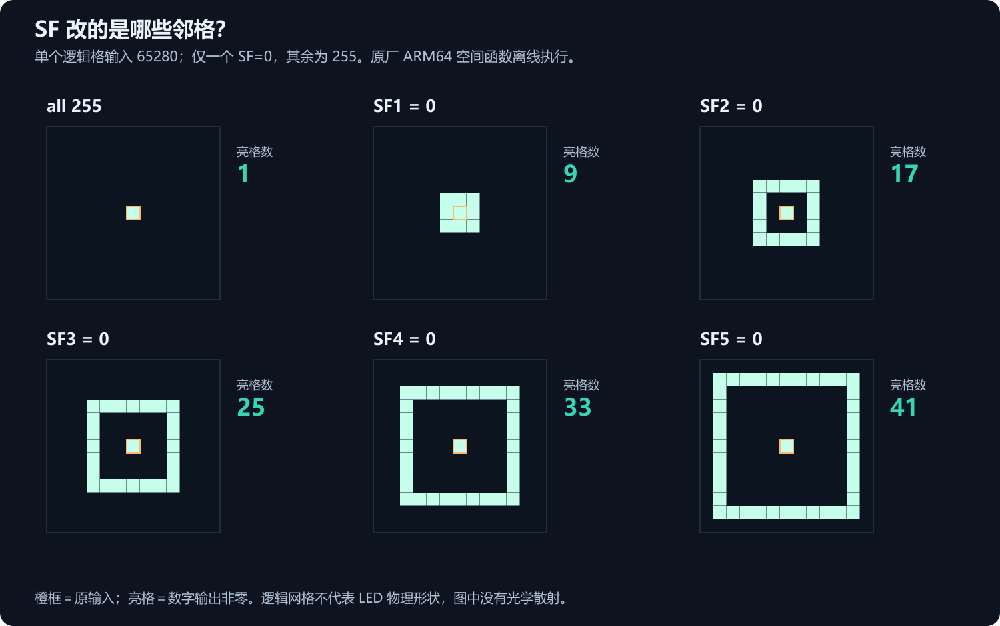
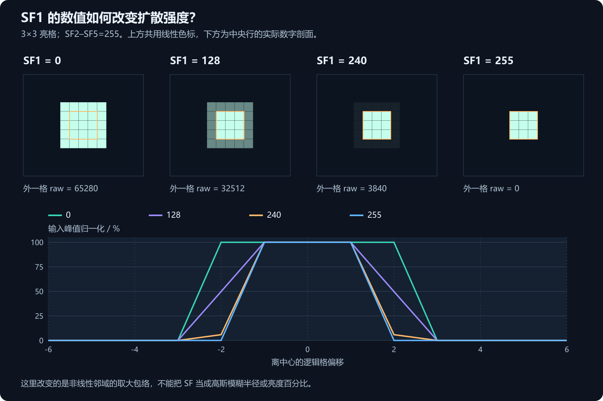
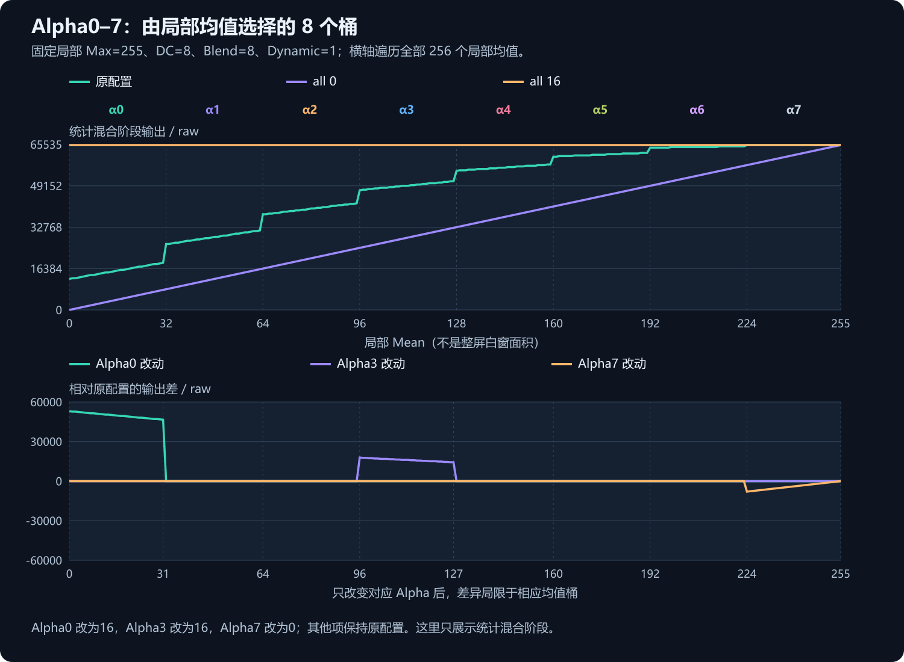
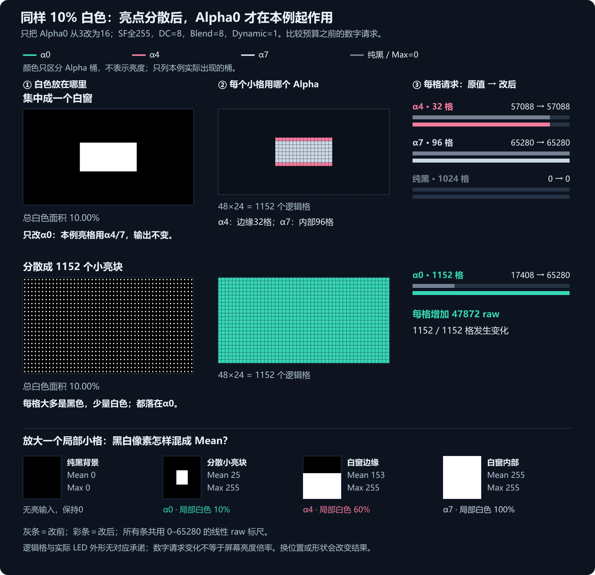
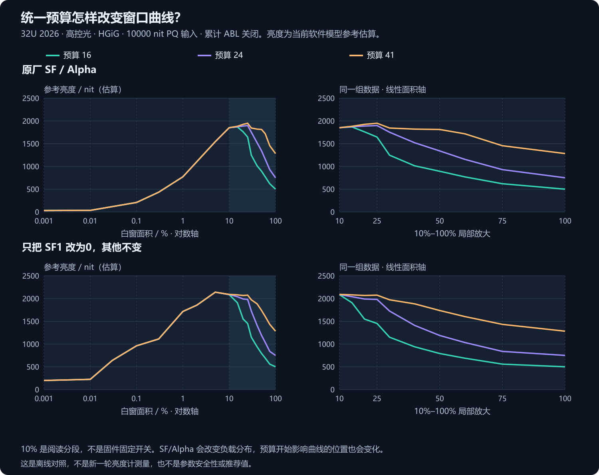
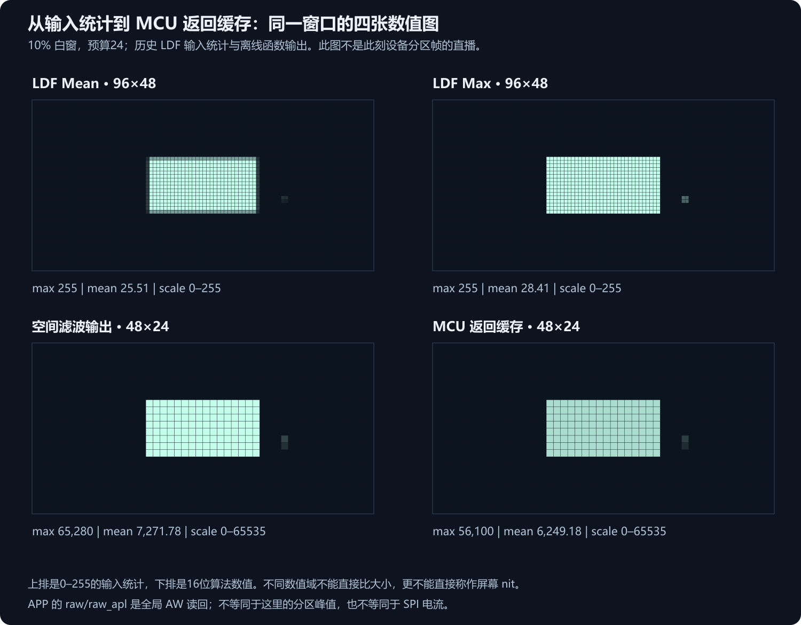

# 调光研究笔记

[English](RESEARCH.en.md) · [主页](../README.md) · [实际操作](guide.zh-CN.md)

这份记录说明参数在已研究驱动中的作用。区分三种证据：**原厂函数离线执行得到的数字输出**、**当前模型的参考 nit 换算**、**历史设备读回**。本轮文档制图没有新增亮度计测量、电流测量或温升测试。

| 固定条件 | 本文取值 |
| :--- | :--- |
| 目标分支 | REDMI 显示器 G Pro 32U 2026，高控光、HGiG |
| 原厂参考 | SF=[255,255,255,255,255]；Alpha=[3,5,7,9,11,13,15,16] |
| 其他统计参数 | DC=8、Blend=8、Dynamic=1 |
| 预算曲线输入 | 10000 nit PQ，累计 ABL 关闭 |
| 48×24 网格 | 算法逻辑坐标，不用于宣称物理 LED 数量或实际分区外形 |

<a id="sf"></a>
## 1. SF：邻域范围、强度与轮廓

### 先只亮一个逻辑格



橙框内输入固定为 65280，其余为 0。每次只将一个 SF 设为 0，其他保持 255：

| 设置 | 非零逻辑格数 | 图里看到了什么 |
| :--- | ---: | :--- |
| 全部 255 | 1 | 保留原输入 |
| 仅 SF1=0 | 9 | 中心加第 1 圈 |
| 仅 SF2=0 | 17 | 中心加第 2 圈，存在空心间隔 |
| 仅 SF3=0 | 25 | 中心加第 3 圈 |
| 仅 SF4=0 | 33 | 中心加第 4 圈 |
| 仅 SF5=0 | 41 | 中心加第 5 圈 |

第 k 圈按网格的 `max(|dx|, |dy|)=k` 划分。单独改变远圈可以得到空心轮廓，因此 SF1–5 不能简单理解成一个连续的“羽化半径”。多圈共同设置才决定完整的边缘包络。

当前非线性空间路径可概括为：

```text
当前格输出 = max(当前格输入, 所有参与邻格输入 − 256 × 对应圈的 SF)
```

每个结果还保留原输入的下界；邻格贡献较小或为负时不会把原输入减暗。边缘按当前算法边界规则处理。公式对应[本项目数值实现](../scripts/response_math.cpp)，图使用本机准备的原厂 ARM64 空间函数执行；没有把任意模糊滤镜当作固件结果。

### 再固定形状，比较不同数值



本例为 3×3 亮格，SF2–5=255。窗口外紧邻格的结果为：

| SF1 | 邻格 raw | 相对输入峰值 |
| ---: | ---: | ---: |
| 0 | 65280 | 100.0% |
| 64 | 48896 | 74.9% |
| 128 | 32512 | 49.8% |
| 192 | 16128 | 24.7% |
| 240 | 3840 | 5.9% |
| 255 | 0 | 0.0% |

这里降低 SF1，扩大了高数字输出的支撑范围；在同一圈中也改变强度。这个“数字边缘”会进入之后的预算路径。肉眼看到的羽化还叠加背光光学扩散、液晶透过和环境因素，无法从这张网格图推导出具体毫米范围或实际暗部 nit。

**实际比较方法：** 固定模式、预算、Alpha 和图样，只改一项 SF。对照纯黑背景上的小亮点、字幕和中等白窗；记录亮点是否更亮、暗部是否抬高、轮廓是否出现断层。随后恢复原值，再比较下一项。大幅改变多项后，难以知道是哪项造成变化。

<a id="alpha"></a>
## 2. Alpha：局部均值分桶，不能套整屏窗口比例

### 先把这几个词分开

把画面看成许多小格：一格里大部分是黑色，只有一个亮点，**平均值可以很低，最亮点仍然很高**。Alpha 决定算法在这一格里更照顾平均状态，还是更照顾那个亮点。

| 词 | 直接理解 | 专业含义与单位 |
| :--- | :--- | :--- |
| **Mean（局部均值）** | 这一小块整体有多亮。 | 驱动局部输入的平均统计，范围 0–255；属于编码统计，不能当作线性光亮度、nit 或整屏 APL。 |
| **Max（局部最大值）** | 这一小块最亮的像素有多高。 | 同一局部输入的最大统计，范围 0–255。少量白点就可能让 Max 到 255。 |
| **桶 / bin** | 按 Mean 选一档参数。 | 把 0–255 划成八段，Dynamic=1 时按 `min(7, Mean//32)` 选择 Alpha0–7。桶是分类范围。 |
| **Alpha 的数值** | 选中那一档后，给亮点多少权重。 | 每档另存 0–16 的参数。例如 Alpha0=3：0 是档位编号，3 才是该档参数值。 |
| **统计输出** | 算完这一格想要多少背光数字请求。 | 本文指统计混合阶段的 16 位结果；后文统一称“混合后请求”，避免与整屏统计混淆。 |
| **raw（原始值）** | 暂时不换算成实际亮度的数字。 | raw 没有统一单位。必须一起看阶段、数值域及是单格还是全局；不同位置的 raw 不能直接比较。 |

### 把一个格子算清楚

下面沿用图中的**分散亮点**：这个逻辑格约 10% 白、90% 黑；在本实验的整数统计中 **Mean=25、Max=255**。固定 DC=8、Blend=8、Dynamic=1，SF 全 255。

1. Mean=25，落在 0–31，所以用 **Alpha0**。画面里白色占整屏多少并不参与这个选档公式。
2. Alpha0=3 时，原厂统计函数返回 **17408**；Alpha0=16 时返回 **65280**。这两个值是同一阶段、同一格子的混合后请求。
3. 为了看清量级，把两者都除以 256：约 **68 和 255**。这只是把数字放回熟悉的 0–255 标尺，仍不代表 68 nit 或 255 nit。原始 16 位结果保持不变。
4. 后面还要经过 SF 空间扩展、MCU/预算处理，以及适用的时间累计机制。总负载被限制时，这一格增加的请求会受到预算分配影响，**17408→65280 不能读成屏幕一定亮 3.75 倍**。

纯黑格 Mean=0、Max=0，本例把 Alpha0 调高仍为 0。集中白窗内部 Mean=255，会选 Alpha7；只改 Alpha0 不改变本例内部的请求。这就是同样 10% 白色面积却有完全不同反应的原因。

**为什么还需要 DC、Blend 和统计修正？** Alpha/16 可以帮助理解基础 Max 权重，例如 3/16=18.75%；原厂算法还会混合其他统计、取整和饱和。这个权重不能直接当作最后的亮度百分比。

Dynamic=1 时，局部均值决定 Alpha 桶：

| Alpha | 局部 Mean | 原厂高档参考值 |
| :--- | :--- | ---: |
| Alpha0 | 0–31 | 3 |
| Alpha1 | 32–63 | 5 |
| Alpha2 | 64–95 | 7 |
| Alpha3 | 96–127 | 9 |
| Alpha4 | 128–159 | 11 |
| Alpha5 | 160–191 | 13 |
| Alpha6 | 192–223 | 15 |
| Alpha7 | 224–255 | 16 |



这张图固定局部 Max=255、DC=8、Blend=8、Dynamic=1。上图展示完整输出，下图只显示单项改动相对原配置的差值。改 Alpha0 只改变此处 Mean=0–31 的结果；改 Alpha3、Alpha7 分别落在对应统计段。

例如 Mean=25 时，Alpha0 从 3 到 16，统计输出由 **17408 → 65280**；Mean=112 时，Alpha3 从 9 到 16，输出由 **49152 → 65280**。这里比较的是统计混合阶段，不是实际屏幕亮度；后面还有空间、预算和设备输出路径。

Alpha 可粗略理解为向局部最大值倾斜的一个权重。实际输出还包含 DC、Blend、统计修正、取整和饱和，不能把 `Alpha/16` 直接当作最后亮度百分比。DC/Blend 目前建议保留所选组合的原值；Dynamic=0 切到固定权重路径，上述按均值分桶的解释不再直接套用。

### 白色集中或分散：同样面积，局部构成不同

本例在 3840×2160 输入中放置 1280×648 白窗，左上角为 (1280,756)；分散输入在每个 80×90 逻辑格的 (28,30) 放一个 24×30 白块，共 1152 个。两幅画面都精确为 10.00% 白色。

**先看白色怎么分布。** 集中成一个白窗时，亮的那几个局部小格本身就很亮；分散成细点时，每格大多为黑、只有少量白色。提高 Alpha0，在下面这个实验中会更照顾后一种格子里的亮点，抬高它们的背光数字请求。总白色面积相同，受影响的区域可以完全不同。



**从左向右读：白色的位置 → 每格选中的 Alpha → 该类格子改前/改后的数字请求。** 灰条是改前，彩条是改后，所有条共用同一标尺；中间的颜色只区分类别。本图只列实际出现的 α0、α4、α7 和纯黑背景，每种颜色旁都有对应格数与数值。

| 本例中的区域 | 格数 | 局部 Mean / Max | 使用哪项 | 只改 Alpha0：3 → 16 后 |
| :--- | ---: | :--- | :--- | :--- |
| 集中白窗边缘 | 32 | 153 / 255 | Alpha4，仍为 11 | 57088 → 57088，不变 |
| 集中白窗内部 | 96 | 255 / 255 | Alpha7，仍为 16 | 65280 → 65280，不变 |
| 窗外纯黑 | 1024 | 0 / 0 | 无亮像素可抬高 | 0 → 0，不变 |
| 分散亮点所在的每个格子 | 1152 | 25 / 255 | Alpha0，3 → 16 | 17408 → 65280，每格增加 47872 raw |

**专业解释：** Dynamic=1 时，Alpha0–7 按局部平均值 Mean 分成 0–31、32–63……224–255 八段，参与与局部最大值 Max 等统计的混合。图中固定 SF 全 255、DC=8、Blend=8，只有 Alpha0 改变。集中白窗的亮格落在 α4/α7；细点让每格平均值降到 25，最亮像素仍为 255，全部落在 α0。纯黑格的 Mean 也为 0，但 Max=0，没有亮输入，本例保持 0。

这些是**预算之前的数字请求**，不能把 17408→65280 直接换成屏幕亮度倍率。SF、全局预算和面板光学继续影响最终结果。Alpha0 不固定控制“某个百分比的小窗口”；较暗的大片内容也可能落在低均值桶。换位置、形状或输入编码，分布会改变。[完整扫描与复现实验](RESEARCH.zh-CN.md#alpha) · [APP 中怎样调](modules.zh-CN.md#halo)

<a id="budget"></a>
## 3. 统一预算：负载变大后，曲线怎样分开



每条曲线都独立执行静态场景，累计 ABL 关闭。比较预算 16、24、41，先用原厂 SF/Alpha，再只把 SF1 改成 0。

原厂 SF/Alpha 的三个读数如下。`peak raw` 是**离线 MCU 返回缓存的最高格值**，不是 APP 全局 AW 读回：

| 白窗面积 | 预算 | peak raw | 参考 nit 估算 |
| ---: | ---: | ---: | ---: |
| 10% | 16 / 24 / 41 | 均 56100 | 均约 1852.0 |
| 25% | 16 | 41909 | 1645.6 |
| 25% | 24 | 48361 | 1899.0 |
| 25% | 41 | 49652 | 1949.7 |
| 100% | 16 | 12191 | 500.6 |
| 100% | 24 | 18287 | 751.0 |
| 100% | 41 | 31242 | 1283.0 |

同一个全局预算，对不同窗口的影响不相同。小窗在当时条件下未触及预算限制，曲线可以重合；大窗受到总负载分配影响，预算变化更明显。SF/Alpha 改变亮格范围和强度，预算作用位置也会随之改变。不能只给 10% 之后乘一个固定倍率，更不能把图中每个面积当作独立可设的控制点。

**10% 仅用来拆图、放大阅读。** 预算字段不检测一个固定的“超过 10% 才开启”条件。预算 raw 和 nit 参考换算也不代表电流、瓦数、温度或安全余量。41/86 是历史短时试验边界，未获得硬件设计上限或长期可靠性依据。

### 累计 ABL 另加一条时间维度

本文预算曲线不含累计 ABL。自定义累计机制根据负载门槛消耗峰值额度，额度耗尽后逐步回落，再按恢复统计决定何时重置。调用次数换成秒需要驱动调用率，不能用桌面刷新率直接代替。`G` 是定点系数，`R` 是恢复统计；两者均不提供温度测量。当前执行适配用于中、高档，低档保留原厂累计路径。[操作与参数](guide.zh-CN.md#budget)

<a id="driver"></a>
## 4. 输入、输出与屏幕亮度：不要跨层混读



| 层级 | 本图/软件中的量 | 可以说明什么 |
| :--- | :--- | :--- |
| 内容输入 | PQ 编码；10000 nit 输入条件 | 内容希望表达的光信号，不是屏幕已经发出的亮度。 |
| 驱动 LDF 输入 | 历史 96×48 的 Mean/Max，0–255 | 局部统计；白窗边缘 Mean 与 Max 可以不同。 |
| 空间阶段输出 | 48×24，16 位 raw | Alpha 与 SF 后的数字分布，本例峰值 65280。 |
| MCU 返回缓存 | 48×24，16 位 raw | 预算处理后的数字分布，本例峰值 56100；不是最终电流实测。 |
| 当前设备遥测 | APP `raw` / `raw_apl` 全局 AW、`raw_spi` 等 | 当前驱动统计，各字段分别保留语义；不能把全局值当最大分区。 |
| 光学结果 | 实际 nit、光晕、色调 | 需要光学测量；软件显示的是受条件限制的参考估算。 |

上排取自历史样本；右下方的小块也保留了样本里的非主窗口亮输入，因此这不是数学上完全纯净的单矩形。标注、桌面遮挡和第二窗口都可能参与驱动统计，小窗尤其明显。下排在本轮重新离线执行，不是此刻显示器帧缓存的实时截图。

不同亮暗模式还会改变 EOTF。HGiG、明亮、层次、动态的内容重映射，与负载及时间限亮需分开讨论。本工具没有编辑完整 EOTF 的控制。跨模式直接套用 HGiG 的 nit 换算会增加误差。

### APP 最后读到的输出，到底是哪一种？

这里要沿两条支路看。**研究图**可以访问离线模型内的每格缓存；**APP 在线侧栏**读取设备导出的遥测字段。这两种访问方式没有提供同一份“最终输出”。

| 位置 | 数值的身份 | 与上一层的关系 |
| :--- | :--- | :--- |
| 局部 Mean / Max | 0–255 的输入统计 | 原始 LDF 为 96×48；模型把对应的 2×2 输入统计交给原厂缩并函数，得到 48×24 逻辑结果。上面的单格示例用于解释其中的统计混合。 |
| Alpha 混合后请求 | 单格 16 位数字，如 17408 | 还没有经过本例后续的 SF 和预算。 |
| SF 后请求 | 48×24 单格数组 | 邻区扩展可能让更多格子得到请求；峰值和总和会有不同变化。 |
| 图中的 MCU 返回缓存 | 离线 48×24 数组，如本图峰值 56100 | 已执行当前预算函数；它仍是数字缓存。此处“MCU 返回”不表示测到了最终 LED 引脚或电流。 |
| APP `raw` / `raw_apl` | **全局 AW 读回字段**，两者是同一来源 | `raw` 是 `raw_apl` 的别名；不等于上一行 1152 格中的最大值，也不能拿来直接乘 Alpha 的增量。 |
| APP `raw_spi` | 驱动原字段 | 保留原值和名称；目前缺少足够依据换算为单区 PWM、LED 电流、瓦数或屏幕 nit。 |
| APP 预估 nit | 当前图样、模式、参数和参考模型的结果 | 使用匹配条件的预测与本轮实际 `gain_used`，不把 AW 当作分区峰值。它不能替代亮度计。 |

**一句话看结果：** 调 Alpha/SF 改变局部数字请求；统一预算重新分配受限负载；累计 ABL 再改变随时间使用的系数。APP 的 AW 是一个全局读回字段，屏幕实际亮度与光晕需要另外观察或测量。

`gain_used` 是本轮实际使用的定点系数 G_prev，65535 表示这一级不再额外衰减；`gain_next` 属于下一轮。负载 L、恢复统计 R 和峰值额度 E 均不提供温度或电流测量。

## 5. 数据与复现

- [完整数据 JSON](assets/research/model-experiments.json)：全部数组、固定条件、源文件指纹和数值结果。
- [采集脚本](../scripts/docs/collect_research_data.py)：使用已在本机准备好的原厂输入，CPU 离线执行，不开启 ADB。
- [制图脚本](../scripts/docs/render_research_figures.py)：从 JSON 绘制中英文 SVG；PNG 是同一 SVG 的栅格版。

已具备本机缓存的研究者可在命令行运行；普通使用无需执行：

```powershell
& "RUNTIME\tools\python\python.exe" "RUNTIME\scripts\docs\collect_research_data.py" --runtime "RUNTIME" --output "OUTPUT\model-experiments.json"
& "RUNTIME\tools\python\python.exe" "RUNTIME\scripts\docs\render_research_figures.py" --data "OUTPUT\model-experiments.json" --output "OUTPUT\figures"
```

`RUNTIME` 为已经合法取得并准备原厂输入的完整便携目录，`OUTPUT` 为新的输出目录。公开包不附带作者的准备缓存；函数执行夹具固定了硬件读取和静态初态，无法代表整个真实驱动的所有时序、温度或保护行为。27 寸不能直接沿用本页的实测依据。
