# First use: from extraction to restoration · 0.9.30-public-preview

[简体中文](guide.zh-CN.md) · [Home](../README.en.md) · [Module reference](modules.en.md) · [Safety](SAFETY.en.md)

Follow this page in order for one temporary session: prepare, tune, check the receipt and restore. Persistence is an optional branch at the end. No coding is required. The UI stays Chinese; bold Chinese labels match its actual controls.

| Reading route | When to use it |
| :--- | :--- |
| **This page: first-use workflow** | First extraction; complete steps 1 → 8 in order. |
| **[Module reference](modules.en.md)** | Look up a button, parameter direction, application method or restore scope. |
| **[Research](RESEARCH.en.md)** | Inspect the experiments behind SF, Alpha, budget and driver values. |

**Screenshots:** all APP tutorial images use **dark MONO (素·黑白)**, captured directly as native lossless PNGs from unchanged areas of the actual 0.9.26 public UI. Open an image for full resolution. ADB was disconnected: disabled controls, dashes and offline messages are genuine. Values identify controls, not recommended settings. Monitor-menu images retain the vendor UI, with cropping and privacy masking only.

## One main route, two endings

**1 Prepare → 2 Enable ADB → 3 Extract, back up and connect → 4 Select a profile and change one item → 5 Check a pattern and receipt → 6 Restore the temporary session → 7 Save the PC draft → 8 Next launch**

For independent monitor operation, separately follow [7B: experimental persistence](#persistent). Each step has a completion check; resolve its message before continuing.

## 1. Prepare the PC and monitor

### 1.1 Scope and other controllers

- Supported branches: **REDMI Monitor G Pro 32U 2026** and **inferred 27U 2026** only. The 27-inch branch has no hardware acceptance and may have various bugs.
- Close every other dimming-controller version normally. Separate folders or PC ports do not prevent competing writes to the same monitor.
- Keep the complete portable folder and initial device backup. Do not run from the ZIP preview or extract only the EXE.
- Windows 11 x64. The recorded system is 25H2, build 26200.8037, RTX 5090 D, driver 32.0.16.2114. If WebView2 is missing, install the runtime from [Microsoft](https://developer.microsoft.com/en-us/microsoft-edge/webview2/) and reopen the app.

### 1.2 Enable Windows HDR

| Click | Expected result |
| :--- | :--- |
| Right-click the desktop → **Display settings**. | Windows System → Display opens. |
| For multiple displays, use **Identify**, then select the target tile. | The selected number matches the physical target. |
| Open **HDR** → enable **Use HDR**. | HDR is on; switching may briefly blank the screen. |
| Return to Display → **Advanced display**. | Check the target's supported resolution and refresh rate. The recorded setup used 3840×2160 and a monitor-reported 160Hz. |

Keep SDR-content brightness, GPU settings and game calibration unchanged during comparisons. Follow [Windows HDR settings](https://support.microsoft.com/en-us/windows/hardware/display-graphics/hdr-settings-in-windows) and [HDR Calibration](https://support.microsoft.com/en-gb/windows/hardware/display-graphics/calibrate-your-hdr-display-using-the-windows-hdr-calibration-app) if needed. **10000-nit PQ input** in this software is not measured monitor peak or a calibration value to copy.

### 1.3 Establish the monitor reference

Use the monitor's normal picture settings: **HDR Game → HGiG → High local dimming → backlight 100**, matching the project's main observations. No factory-menu access or system-menu modification is required.

HGiG, Bright, Gradation and Dynamic remap content and change EOTF, separately from APL/ABL limiting. The software selects existing modes; it has no complete EOTF editor. Keep this mode fixed when comparing curves.

**Step 1 complete:** scope checked, other controllers closed, Windows HDR and the monitor reference mode fixed.

## 2. Enable ADB and authorize the PC

ADB connects the PC to the monitor's embedded system. A working video signal does not establish ADB.

### 2.1 On the monitor · actual captures

These screens come from the **REDMI Monitor G Pro 32U 2026 / OS3.0.120.0.UFFMAMN**. The verified route is **控制 → 设置 → 账号与安全 → ADB调试** (Control → Settings → Account & security → ADB debugging). The switch is directly visible in this unit's vendor settings; no generic Android TV developer-mode activation is required by this walkthrough.

#### ① Open the control sidebar and choose Settings

Long-press the remote's **menu key (≡)**. Select **控制** at the top, press Down to **设置**, then Confirm.

[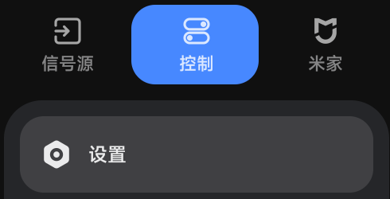](assets/screenshots/monitor-01-control.png)

The equivalent long-press menu event received by the monitor was used to verify this route. Physical chassis-button placement/hold combinations were not separately photographed. With chassis controls, use the device's own entry to reach the same Settings screen.

#### ② Select Account & security on the left

Use Up/Down to find **账号与安全** near the bottom of the sidebar, then Right to enter its settings.

[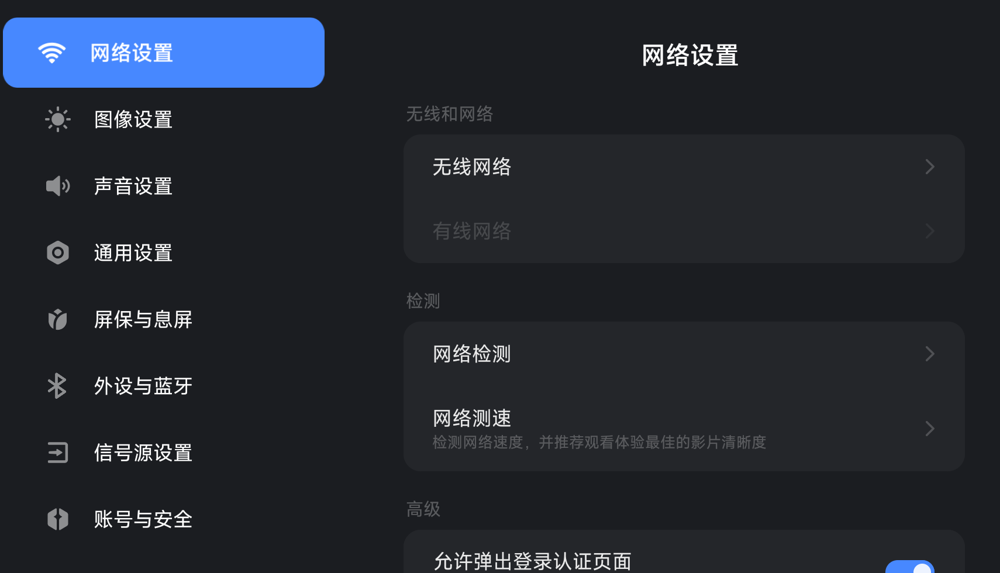](assets/screenshots/monitor-02-settings.png)

#### ③ Find ADB debugging and leave it enabled

Use Up/Down to focus **ADB调试**. If off, Confirm and follow the system permission prompt. If already enabled, leave it unchanged. The highlighted row/switch below is genuine; the account identifier is masked.

[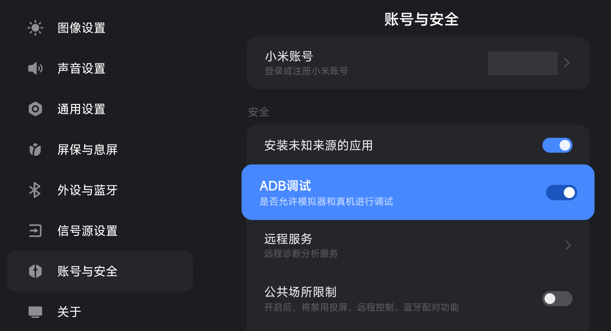](assets/screenshots/monitor-03-adb.png)

**Only follow the ADB step.** Other switches, including unknown-source installation, show pre-existing state and are not instructions to enable them. Capture did not toggle debugging, reset authorization or change dimming parameters.

#### ④ Connect and authorize the PC

Connect the USB data channel or use the same trusted LAN, then click **自动寻找并连接** in the app. If a first-time RSA prompt appears, allow the PC on the monitor; “always allow” is optional for a trusted personal PC. This device was already authorized; its keys were not revoked or a first-time dialog fabricated for the guide.

**Watch for permission prompts during connection:** if the PC or monitor asks you to authorize ADB debugging or approve administrator access for this ADB connection, choose **Allow** (or **Yes** in Windows), then return to the app and wait for connection to finish. Prompts depend on the system and its current authorization state.

#### ⑤ Check the system version

Return to vendor Settings and select **关于** (About). The recorded screen shows **3.0.120.0**, with full system identifier **OS3.0.120.0.UFFMAMN**. Viewing this page does not require updating firmware.

[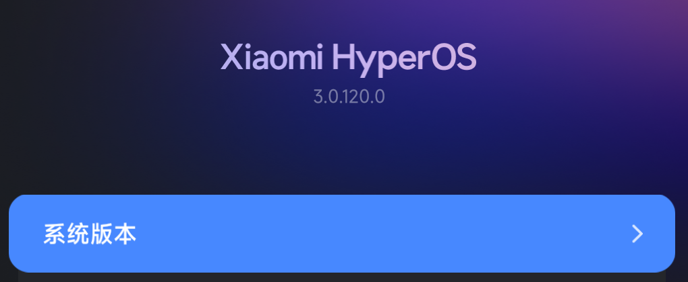](assets/screenshots/monitor-04-about.png)

This verifies the current personal unit's menu route, not a factory-reset first-activation sequence. If another firmware differs, check its actual version/entry rather than forcing a generic TV tutorial.

### 2.2 USB or LAN

| Connection | Action | Common confusion |
| :--- | :--- | :--- |
| **USB** | Use a data-capable cable and the channel exposing the monitor system's ADB. Windows Device Manager should show a working MiTV-MFFU1 / Android ADB interface. | HDMI/DP carry video; charging-only cables, wrong ports and driver errors do not establish ADB. The app does not switch USB roles. |
| **LAN** | Put both devices on the same trusted network; read the monitor IP. Try automatic discovery before advanced connection. | Use the actual exposed `HOST:PORT`; do not assume 5555. Complete any system wireless-pairing-code procedure first. |

`unauthorized`: check the RSA prompt on the monitor. `offline` or not found: check debugging, data/network connection and conflicting tools. Do not terminate every unfamiliar adb.exe. ADB may need re-enabling after reboot.

### Automatic discovery and manual fallback

0.9.30 checks connected USB/network ADB transports, advertised connect ports, successful records and known neighbours. It validates supported devices, excludes unrelated phones and separates pairing from connect ports. USB and Wi-Fi entries for one physical display are deduplicated. Two supported displays require an explicit choice.

There was no second physical display or LAN available. Foreign serials, different private IPv4 ranges, multiple-interface neighbours, dynamic advertised ports, authorization failure and ambiguity were simulated. Router isolation, blocked advertisements, absent neighbour records and unadvertised custom ports can still prevent discovery.

Open **高级连接** and enter your own USB serial or `HOST:device-port` in **设备地址 / USB序列号**, then click **按高级参数连接**. **本机ADB服务端口** belongs to the PC ADB server; 5041 is not the display's port. Legacy network ADB checks port 5555 on known neighbours only, without sweeping the subnet. Modern wireless-debug pairing must first be completed through the system.

[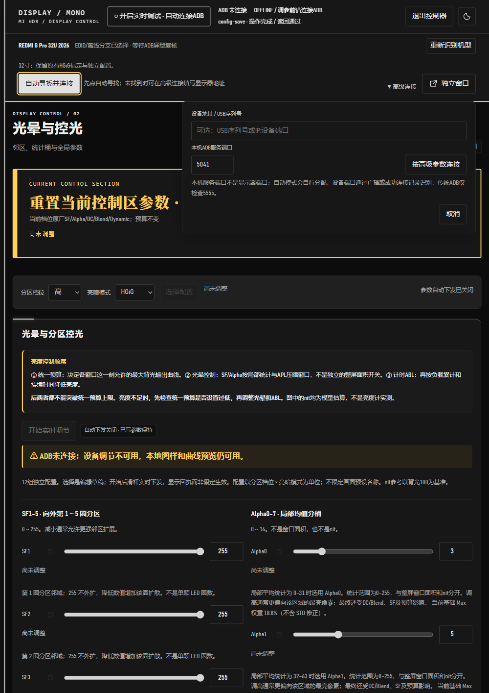](assets/screenshots/app-21-adb-advanced.png)

See the [Android ADB documentation](https://developer.android.com/tools/adb) and [AOSP wireless ADB design](https://android.googlesource.com/platform/packages/modules/adb/+/HEAD/docs/dev/adb_wifi.md). This tool does not bypass RSA authorization, enable root or disable network isolation.

**Step 2 complete:** ADB is enabled and its data channel is ready. First-PC authorization is handled during connection in the next step.

## 3. Extract, select model, backup and connect

### 3.1 Open the program

1. Extract the entire ZIP into a new folder.
2. Open **MI HDR Control.exe**. `启动控制器.cmd` starts the same native window.
3. Read **开始使用前** (before you start): concise equipment risks, backup and normal-exit instructions. Click **知道了** (understood) to continue.
4. Check the detected size/branch, then choose **进入对应工作台** (enter selected workspace). For preview only, expand **未接入目标显示器？仅离线查看** (offline view).

[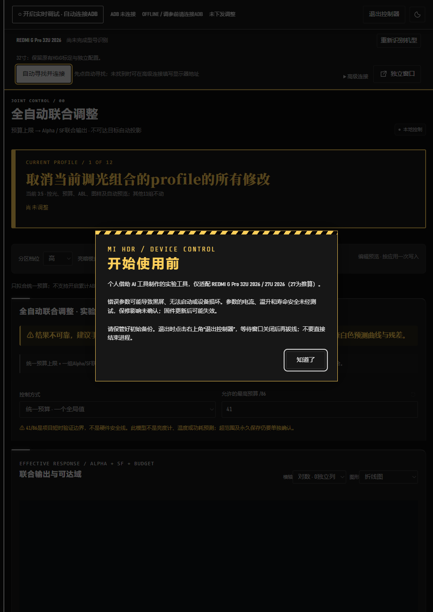](assets/screenshots/app-00-startup.png)

[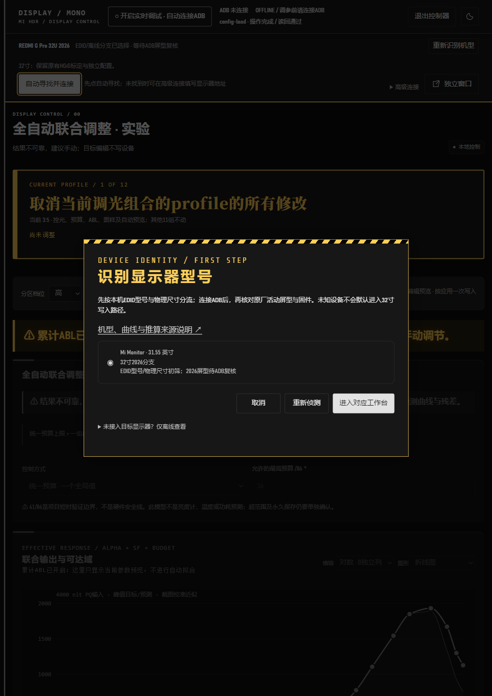](assets/screenshots/app-01-model.png)

EDID is preliminary. ADB later checks the active panel and firmware. Stop if the branch is wrong; do not select a similar model to bypass it.

**Window and navigation:** 0.9.30 opens in portrait A4 proportions, constrained by the available desktop height. In a narrow window, reveal navigation by moving to or clicking the thin left edge, then select a module. Scroll for lower controls and readback. Tutorial captures are actual 1000×1414 lossless PNGs; open the originals for detail.

### 3.2 Connect first, then inspect existing backups

1. Click **自动寻找并连接** (find and connect). Accept the RSA authorization or administrator confirmation for this ADB connection with **Allow**/**Yes** when prompted.
2. Wait for active-panel, firmware and current-device backup checks. Before connection, “backup not inspected” does not mean the monitor has no backup.
3. **Valid backup found:** reuse it. A monitor-only copy is recovered into the current portable folder. No storage-choice dialog is needed; dismiss the completion notice with **知道了**. A freshly extracted package follows the same discovery process.
4. **No backup found after inspection:** the storage-choice dialog opens. PC backup is mandatory; optionally select **同时保存到显示器**, click **保存选择**, and wait for verification.
5. **Read failure, corruption, wrong identity or conflicting copies:** resolve the reported error and preserve existing files. The program does not create a replacement over them; tuning writes remain unavailable.

Keep a separate copy of the portable-folder backup; do not upload it to GitHub. It records the state at first backup and is used with matching firmware defaults during restoration. An old PC-only backup must be retained from its original portable folder.

### Portable data: backup and runtime locations

PC backups are located relative to the **current extracted package root**, expanded to full paths at runtime. The author's drive/install path and the launch working directory are not used. The UI displays the resolved path for convenience.

| Data | Relative to the portable folder |
| :--- | :--- |
| Initial device backup | `state/device-backups/DEVICE_KEY/initial-v1.json` |
| Controller configuration | `profiles/controller.json`, `profiles/models/` |
| Locally prepared components/models | `state/prepared/` |
| Fitting-response cache | `state/response-model/` |
| ADB authorization files | `state/android/` |
| WebView2 data/cache | `state/webview/` |
| App logs/operation records | `logs/`, `experiments/` |
| Temporary files/pattern records | `tmp/`, `captures/` |

Exit normally with **退出控制器**, then move/rename the complete folder, including `state` and `profiles`. Moving only the EXE loses its supporting files. Public packages exclude the author's personal runtime data.

**Manual JSON export** uses the location you choose in Save As, inside or outside the package. The optional monitor-side backup stays on the device and is selected separately.

The test package was moved/renamed to a Unicode/space-containing directory and launched from an outside working directory. Actual ADB reconnection reused the identical backup without duplication, retained usable prepared caches and left dimming readback values unchanged.

### 3.3 Finish local preparation and enable live debugging

1. Continue waiting for first-run local preparation; a verified existing backup needs no repeated storage choice.
2. Wait for active-panel, firmware and backup checks. First connection reads originals from your own monitor and prepares the required adapter/model cache locally.
3. Check status and errors. Resolve incomplete preparation, fingerprint mismatch or backup failure before tuning.
4. After connection, click **开启实时调试 · 自动连接ADB** in the top bar and wait for debugging readiness. Then select **分区档位** (local-dimming level) and **亮暗模式** (tone mode), and click **选择配置** (select profile). There are 3×4=12 combinations.

[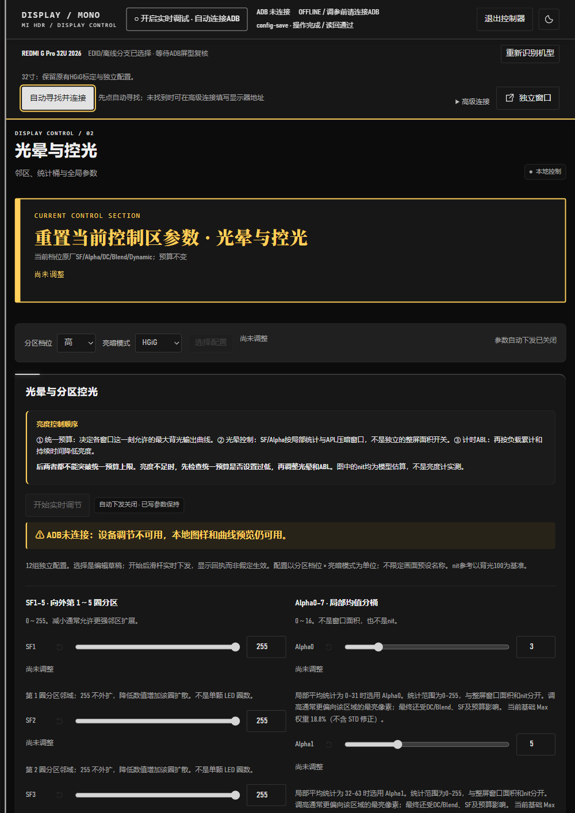](assets/screenshots/app-03-connect.png)

No AI, Ghidra, JDK or compiler is needed. `state/prepared`, device backups, connection records and logs are private runtime material, excluded from future public exports. For a manual address, expand **高级连接** (advanced connection) and enter your own `HOST:PORT`.

**Step 3 complete:** identity/firmware checks, initial backup and local preparation succeeded; debugging and the selected profile are ready.

## 4. Select the profile, then change one item

1. Confirm top-bar live debugging is enabled, ADB is online, and model/backup checks are complete. The switch reads **开启实时调试 · 自动连接ADB** before enabling.
2. Choose **分区档位** (level) and **亮暗模式** (tone), then click **选择配置**. The other eleven combinations remain independent.
3. Open **光晕与控光 02**. Record the original value of one item and read its [direction of effect](modules.en.md#halo). Make one small comparison; the interface range is not a tested safety range.
4. Check **开始实时调节** before editing the number box. In this version, editing a bloom parameter in an already selected profile also enables automatic submission, so an edit may reach the device immediately.
5. Check **下发序号 / 设备回执** and the current error message. An asterisk only marks a difference from defaults.

[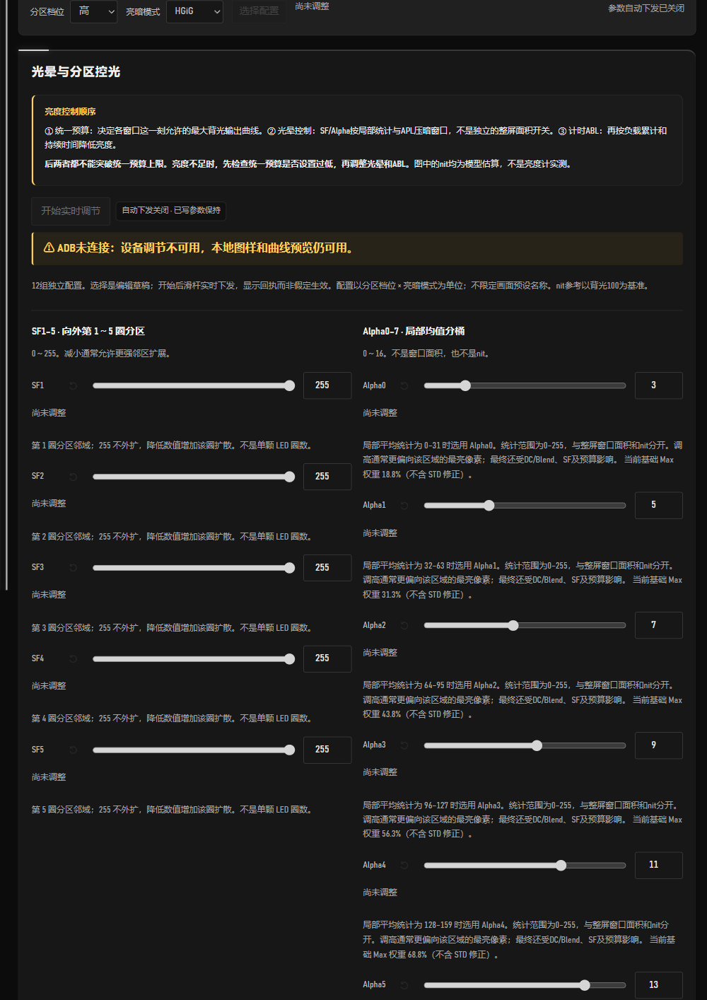](assets/screenshots/app-04-halo.png)

**Completion check:** the intended profile and single change have a matching receipt. For larger-window output, use [01 Budget](modules.en.md#budget); it requires **应用统一亮度设置 · 一次写入**, unlike the live bloom sliders.

### Top-bar A/B comparison: default ↔ tuned

With live debugging enabled and the current adjustment acknowledged, click **调节后配置 · 对比默认**. The button becomes **显示器默认 · 切回调节**; click again to restore the SF, Alpha, budget and cumulative-ABL parameters applied before this comparison. The selected local-dimming level and tone mode remain the comparison context, and the HDR pattern stays open. Cumulative ABL restarts its timing when restored; use the same observation duration when comparing sustained output.

Unapplied drafts are preserved and excluded from the comparison. All twelve drafts and the saved permanent scheme remain intact. Default comparison pauses the custom budget and uses this combination's factory dimming path. Applying edits, selecting another combination or ending live debugging ends this comparison. Resolve readback errors before treating a switch as complete.

### Inspect HDR mapping after Apply

In **APL与ABL控制 01**, edit the budget or cumulative ABL and click **应用统一亮度设置 · 一次写入**. The HDR status at the page top reports synchronization. P0 is an input-domain TMO target, not a luminance-meter reading. Resolve zero-budget or profile/mode mismatch states as shown. Stopping debugging, lease expiry and unloading restore the factory capability table; default A/B comparison pauses the override too.

If mapping fails to activate, this build stops both the custom budget and PC renewal while retaining drafts. The prediction is not an applied-state receipt. [Details](modules.en.md#hdr-mapping)

## 5. Compare a pattern briefly, then inspect readback

1. Open **HDR 图样 04**. Start with **窗口预览**, one row and one column, your chosen window area and **PQ 输入 nit**.
2. Check **时长秒** (duration); 0 means unlimited. Use a short duration for the first comparison and do not leave bright large windows unattended.
3. Click **显示 HDR 图样**; after edits, click **更新图样参数**. Hold area, position, input and monitor mode constant.
4. Compare the highlight, surrounding dark area, edges and sustained output. Brighter small highlights generally make nearby bloom more visible.
5. Inspect fresh **设置 / 驱动读回** values on the right, or **传感器与记录 05 → 读取传感器**. Missing values stay as dashes, not zero luminance.

[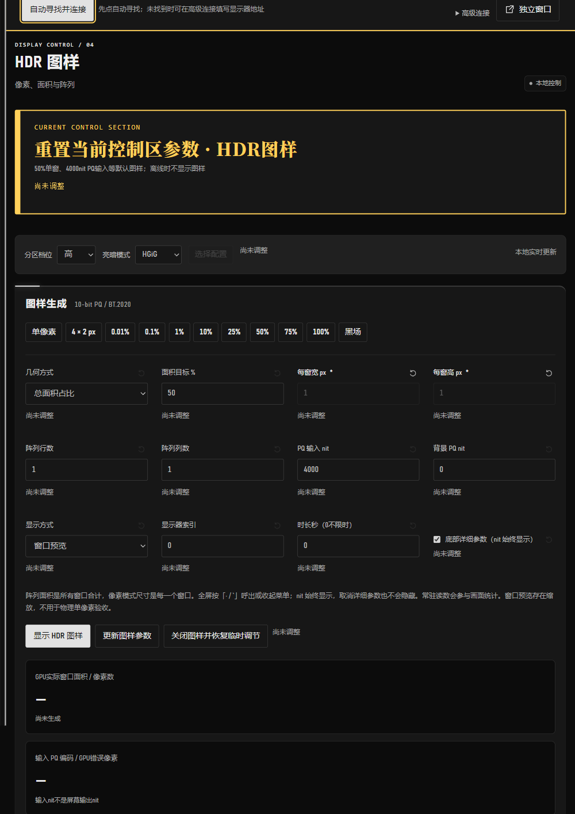](assets/screenshots/app-07-pattern.png)

**Completion check:** record the pattern/input conditions and keep them identical between comparisons. PQ input, model-estimated nits and measured luminance are different quantities. See [04](modules.en.md#pattern) for pixel-accurate fullscreen/arrays/GPU checks and [05](modules.en.md#readback) for driver and temperature readings.

## 6. End the temporary session and confirm restoration

1. Stop editing. In **HDR 图样 04**, click **关闭图样并恢复临时调节** and inspect the receipt; use `Esc` to leave fullscreen first if needed.
2. Turn off top-bar debugging with **关闭调试 · 恢复默认并断开**. Wait for restoration and disconnection before exiting.
3. If **恢复/断开未确认 · 重试关闭** appears, preserve the error and retry after resolving the connection. A closed window does not prove restoration.

**Completion check:** successful temporary-restore receipt and the requested ADB disconnection. Turning off the module-02 live button only pauses further submissions and holds written values; ending the whole session restores its temporary state.

A resident scheme is paused for the current boot when the PC takes over. Ending PC debugging does not clear that pause. After confirming the temporary session has ended, save the resident scheme again or let the next normal boot load it. See the [restore-scope table](modules.en.md#restore-scope).

After the restore/disconnect receipt, click the APP's top-right **退出控制器** and wait for the window to close before disconnecting cables or shutting down. Do not terminate the process in Task Manager. Forced termination bypasses normal saving, temporary restoration and cleanup, so parameter/lease state may remain unconfirmed. After an abnormal exit, reopen, inspect fresh readback and follow recovery steps; disappearance of a window does not establish restoration.

## 7. Keep settings: save on the PC first

### 7A. Everyday route: PC draft and JSON

Values, patterns, themes and fitting targets autosave on the PC. Check the save status at the bottom of the sidebar; no manual Save button is needed. For a separate backup or migration:

1. Open **配置与设备 06** and click **导出 JSON** (export JSON).
2. In the Windows **导出控制器配置** dialog, choose a folder and filename, then **保存** (save). Locations outside the portable folder are supported; Cancel leaves no export.
3. In the new package, click **载入 JSON**, choose the saved file and verify its model/profile.

This saves PC configuration only. Monitor startup persistence is a separate operation.

[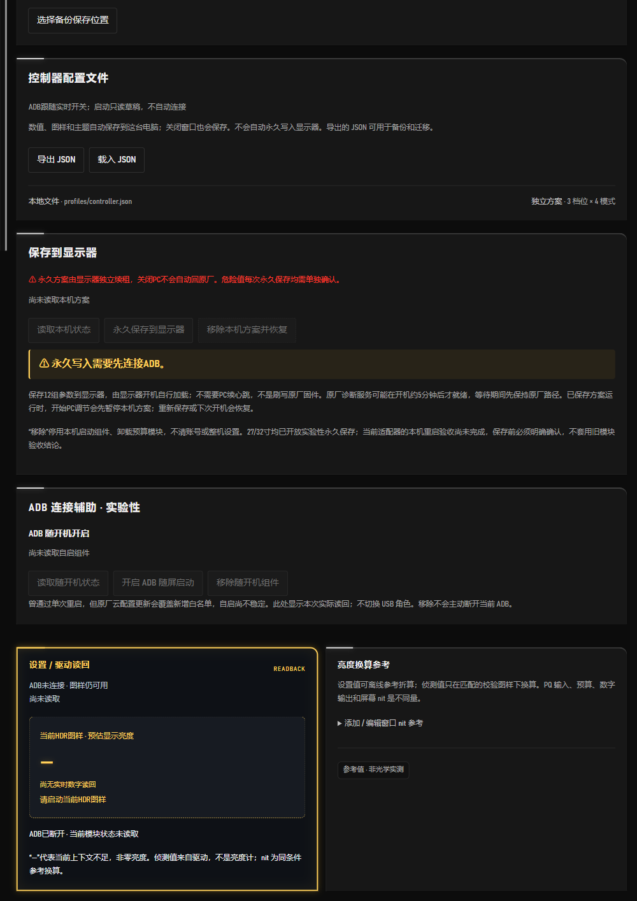](assets/screenshots/app-13-profiles.png)

**Completion check:** keep the saved/exported PC file and initial device backup separately.

### 7B. Optional: persistent monitor save · experimental

Use only after understanding the risks and checking temporary tuning/restoration. Open **配置与设备 06 → 保存到显示器**:

1. Reconnect and verify the initial backup and all twelve profiles.
2. Click **读取本机状态**, check the intended contents, then **永久保存到显示器** and read the confirmation.
3. Check the current boot's scheme summary and fresh heartbeat. A save receipt does not replace reboot acceptance.
4. To undo, click **移除本机方案并恢复**, then wait for module/lease/parameter checks. For all dimming paths affected by this tool, use **恢复设备出厂调光** at the page top.

Complete reboot acceptance of the current adapter remains unfinished: `boot_verified=false`. Ordinary first use does not require a reboot experiment. Persistence can run after the PC closes, and firmware updates may invalidate it. **恢复设备出厂调光** affects this tool's dimming scope, leaving accounts, launcher and the full system intact. See [06 Saving/restoration](modules.en.md#save-restore) for the full procedure and failure limits.

## 8. Next launch or portable-package update

- Check model, ADB and profile before enabling debugging. Loading a PC draft at launch does not imply connection or submission.
- Before upgrading, exit the old controller, export JSON and preserve the initial backup. Extract into a new folder and reconnect/prepare there; do not copy old `state`, caches and logs wholesale.
- Stop on a firmware or file-fingerprint mismatch and keep the error. Do not edit checks to force compatibility.
- For `unauthorized`, handle the monitor's RSA prompt. For `offline`, check ADB, cable/network and competing controllers. ADB may need manual re-enabling after reboot.

**One complete session ends here.** Use the [module reference](modules.en.md) for later questions. The author's repeatable public-package process is documented in [personal-to-public releases](RELEASING.en.md).
